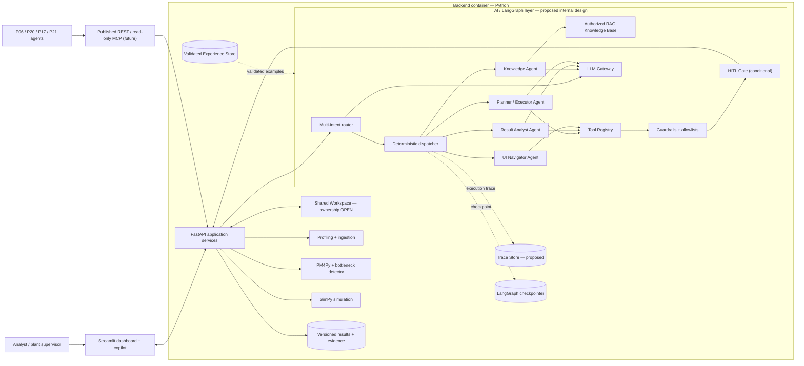
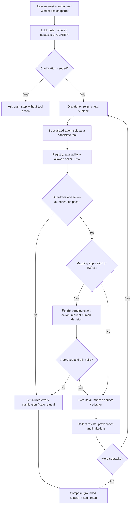

# P05 — AI/Agentic Layer Architecture (Static and Dynamic Views)

> **Status:** WORKING DESIGN PROPOSAL — group review required.  
> **Related task:** [TASK-07, issue #12](https://github.com/ArturRembas/p05-bottleneck-detection/issues/12).  
> **Reference date:** 24 November 2026.  
> **Relationship to TASK-06:** This document describes the *components, state and interaction flows*. The candidate capabilities, API boundaries and risk tiers are inventoried separately in [AI_API_REQUIREMENTS.md (PR #13)](https://github.com/ArturRembas/p05-bottleneck-detection/pull/13). PR #13 is still under review, not an approved contract.

## 1. Purpose, scope and decision status

The P05 agentic layer assists users in interpreting deterministic bottleneck findings, understanding authorized operational documentation, proposing semantic mappings, and interacting with the P05 application through governed tools. It does not replace deterministic event-log processing, bottleneck detection or SimPy calculations.

This specification is an **M1 design baseline for review**, not evidence that any of its agentic workflows have been implemented or tested. It describes the full target architecture while distinguishing the smaller proposed M2 prototype subset.

### 1.1 Decision/status register for this document

| Item | Status at this baseline | Basis / qualification |
|---|---|---|
| Python, FastAPI backend, Streamlit UI, two-container Docker Compose deployment | **Group-approved architecture**, as reported by project scope/checkpoint | Backend modules are not separate microservices. |
| LangGraph-based router/agents, RAG Knowledge Base, separate validated Experience Store | **Group-approved architecture**, internal behavior still under review | See project scope and 6 November presentation. |
| OpenAPI 3.1 and read-only MCP integration | **Group-approved integration direction** | Exact endpoint contracts/permissions remain to be agreed. |
| Multi-intent router, deterministic dispatcher, four specialized agents, template-first Planner | **Luca's layer-level design**, pending formal group/decision-register confirmation | Do not label the four-agent decomposition as separately ratified. |
| Tool Registry, Guardrails, R0–R3 tiers, HITL Gate, LLM Gateway, Trace Store | **Luca's layer-level design**; details proposed | Tool discovery is never automatic authorization. |
| Backend Workspace ownership and Streamlit synchronization | **Open** | Recorded as OPEN-25 in the working context; no final contract assumed. |
| LangGraph pause/resume exposed through Streamlit | **Proposed implementation pattern, unverified in P05** | Requires an integration prototype and durable state/audit policy. |
| Exact model/provider, database, RAG corpus, Experience Store policy | **Open or provisional** | No provider selection or persistence technology is locked by this document. |
| Agent-facing operation inventory | **Proposed in TASK-06 / PR #13** | Its names and risk assignments are not production API commitments. |

The group decision register, SRS v0.2 and consolidated Chat 02 use cases still require reconciliation before final approval. This document assigns **no invented decision IDs**.

### 1.2 Architectural invariants

1. **No LLM calculations:** metrics, graph structure, ranks and simulation outputs come from deterministic services. AI statements must reference their source evidence and limitations.
2. **Mandatory mapping confirmation:** a model's mapping suggestion cannot become an applied mapping without an authenticated human decision before full ingestion.
3. **Trusted enforcement:** R2/R3 actions and external publication require server-side authorization, an exact-action human decision and an auditable record. An agent never self-approves.
4. **Separated result categories:** measured/derived/unavailable deterministic facts, AI hypotheses/explanations and simulated estimates remain distinguishable.
5. **Independent deterministic path:** ingestion/analysis services can operate without the LLM, RAG or agentic router; failure of an AI feature must not fabricate a result or silently run a pending action.
6. **Privacy and data lineage:** only authorized, minimized/pseudonymized profiles or evidence are sent to external model providers; mock/synthetic data are clearly labeled.
7. **Single application-service boundary:** dashboard and agentic adapters use the same reviewed backend domain services where applicable. UI-specific actions or RAG adapters need not each be a REST endpoint.

### 1.3 Diagram notation and editable sources

The architecture is represented by **two embedded Mermaid diagrams** and **two UML Sequence Diagrams authored in Visual Paradigm 18.1**:

| Section | View | Authoring format | How to inspect |
|---|---|---|---|
| §2 | Static components and dependencies | Embedded Mermaid `flowchart` | Rendered directly in the Markdown document on GitHub |
| §3.1 | Dynamic request routing and execution | Embedded Mermaid `flowchart` | Rendered directly in the Markdown document on GitHub |
| §3.3 | AI-assisted semantic mapping | Visual Paradigm UML Sequence Diagram | Open `IT.1 - AI-assisted Semantic Mapping` in the Visual Paradigm project |
| §3.4 | R2/R3 human-in-the-loop | Visual Paradigm UML Sequence Diagram | Open `IT.1 - HITL` in the Visual Paradigm project |

The two Sequence Diagrams are authored and maintained in **Visual Paradigm 18.1**. Their editable source project, [`P05 - Bottleneck Detection 1.vpp`](diagrams/P05%20-%20Bottleneck%20Detection%201.vpp), **is included in the proposed TASK-07 commit** at `docs/diagrams/P05 - Bottleneck Detection 1.vpp`. The document references the diagrams by their exact names: **no PNG/SVG exports or embedded images are planned**. Reviewers must open the `.vpp` file in Visual Paradigm to inspect them; GitHub cannot render its internal diagrams. The project file may also contain other diagrams and project metadata, which must be checked before publishing to this public repository. The linked file is available after both files have been committed to the stated paths.

The visual models illustrate **proposed behavior**. Their creation does not prove that endpoints, checkpointers, approval services or application workflows are implemented.

## 2. Static view — components and responsibilities

The approved deployment comprises **one backend/system container** (Python modules for FastAPI, ingestion, PM4Py, simulation and AI) and **one Streamlit UI container**. Boxes inside the backend in the diagram are logical responsibilities, *not* new independently deployed services.

**Diagram reading rules:** solid arrows show the proposed primary communication paths; dotted arrows indicate shared context, governance or future/conditional integration. The `Gate → API` arrow is a conceptual authorization boundary; internal adapters may invoke the *same application services* without a network round trip, but may not bypass their authorization rules. The diagram is not evidence of deployed endpoints.

### 2.1 Four specialized agents

| Component | Intent | Main responsibility | Boundaries |
|---|---|---|---|
| **Knowledge Agent** | `INFO` | Answers informational questions using authorized RAG passages with resolvable citations or abstention. | Does not derive process metrics from documents or access unapproved corpora. |
| **Result Analyst Agent** | `DATA-QA` | Reads existing KPIs, variants, rework and candidate bottleneck evidence; prepares grounded explanatory answers. | Read-only tools by default; cannot alter rankings or claim causal proof. |
| **UI Navigator Agent** | `UI-CONTROL` | Translates user requests into validated filters, views and selections. | Reversible R1 actions; exact Streamlit ↔ Workspace contract remains open. |
| **Planner/Executor Agent** | `EXECUTE` | Coordinates predefined Ingestion, Bottleneck analysis, What-if and Output & publish pipelines, with constrained parameter filling; may propose an explicit free plan for requests outside templates. | Never skips risk checks or performs deterministic computation inside the LLM. |

There is **no separate Process Analyst or What-if Agent** in this baseline. The corresponding functions are Planner/Executor workflow domains. Splitting agents later would require a functional/test-based justification, not only a larger number of tool names.

### 2.2 Cross-cutting components and state boundaries

| Responsibility | Role | Separation / unresolved aspect |
|---|---|---|
| **Tool Registry** | Stable logical names, typed schemas, adapter kind, allowed callers, risk tier, availability and ownership. | May derive REST metadata from reviewed OpenAPI; non-REST tools are declared explicitly. Registry inclusion does not grant permission. |
| **Guardrails** | Deterministic argument checks, field/value existence, privacy filtering, evidence checking and bounded error handling. | Fail closed on unsupported requests or `501`; prompt instructions alone are not sufficient. |
| **HITL Gate** | Holds R2/R3 actions and any mapping application pending an authenticated human decision. | Human approval must be tied to the exact operation, parameters and relevant version. |
| **LLM Gateway** | Centralized provider adaptation, prompt/model versions, timeout/retry and data-minimization checks. | Model/provider is provisional; changing providers must not change deterministic results. |
| **RAG Knowledge Base** | Indexed, access-controlled technical documentation and operational procedures. | Separate from the Experience Store; retrieval results must carry source IDs. |
| **Experience Store** | Human-validated examples for few-shot reuse (e.g., corrected column mappings). | Write only under an approved validation/retention policy; not the RAG document corpus. |
| **Trace Store** | Proposed append-only record of requests, decisions, tool calls, sources, errors and approvals. | It is not the same thing as LangGraph checkpoints; exact persistence choice remains open. |
| **LangGraph checkpointer** | Per-thread graph execution state used for resume/recovery. | A durable checkpointer is necessary for recovery across backend restarts; it is not a substitute for audit records. |
| **Shared Workspace** | Active dataset/analysis, mapping revision, selected process element, filters and view. | Backend ownership, lifecycle and Streamlit synchronization remain OPEN; minimal M2 scope is proposed. |
| **Backend analysis repository** | Stores deterministic results/evidence with versions and availability semantics. | Ownership and exact storage contract are outside this task and depend on core/API design. |

## 3. Dynamic view — request routing and tool execution

### 3.1 Normal interaction

The following is a **candidate control-flow model**, not an implemented LangGraph graph. The router produces an ordered list of `{intent, text}` subtasks or requests clarification. The dispatcher is deterministic: it selects the specialized agent and enforces the sequence, passing along authorized results.

**Trust boundary:** every callable action, including a nested or agent-generated call, must pass through policy enforcement. An R0 tool is still subject to data access controls; a cloud LLM invocation is additionally subject to the data-transfer policy. UI confirmation is not sufficient by itself: the backend validates the authorized actor and exact request before the side effect.

**Atomicity:** a compound request may finish some R0 reads before an R2/R3 step pauses or fails. It must expose its actual partial completion and never claim that the entire workflow executed successfully.

### 3.2 Workflow templates under Planner/Executor

| Template | Typical steps | Expected human boundary |
|---|---|---|
| Ingestion | Profile log → propose mapping → show/correct mapping → confirm → deterministic ingestion | Mapping confirmation always; full ingestion guarded. |
| Bottleneck analysis | Select approved dataset/mapping → deterministic discovery/detection → read evidence → optional AI explanation | Only if a particular operation is costly/persistent; explanation does not change metrics. |
| What-if | Propose countermeasures → validate scenario assumptions → request SimPy simulation → compare deterministic/simulated evidence | Simulation R2 before execution. |
| Output & publish | Assemble/read results → prepare artifact → request publication → retrieve published revision | Report/export classification open; external publication R3. |

### 3.3 Sequence — AI-assisted semantic mapping (UC02)

The model sees **only an authorized, minimized/pseudonymized profile and bounded samples**. A suggested mapping has no operational effect until a human approves or corrects it. A rejection does not trigger ingestion.

**Visual Paradigm reference:** Open the [editable Visual Paradigm project](diagrams/P05%20-%20Bottleneck%20Detection%201.vpp) and select the UML Sequence Diagram **`IT.1 - AI-assisted Semantic Mapping`**.

**Diagram 3.3 — Intended interaction:** deterministic profiling, bounded AI mapping proposal, explicit human confirmation/correction, and guarded deterministic ingestion. The diagram is **not embedded** in this Markdown document; the Visual Paradigm project is required to view it.

**Scope clarification:** the Visual Paradigm diagram labels a possible input as `CSV/XES/OCEL`. This is an illustrative target-format label, **not evidence of approved OCEL ingestion**: the current OpenAPI v0.2 scaffold accepts CSV/XES, and the scope of OCEL support remains open. The implemented behavior must follow the reviewed ingestion contract and the group-approved format scope.

**Approval scope:** if the approved mapping decision is also intended to authorize the exact ensuing full-ingestion action, this binding must be explicit and verified by the backend; otherwise a separate R2 confirmation is required. No automatic ingestion follows an unrelated mapping approval.

**Experience Store (conditional side path):** an approved correction *may* yield a privacy-minimized candidate training example after an additional validation/retention policy check. It is not written automatically merely because a user pressed Confirm; its exact policy remains open. This does not affect the core mapping approval.

**No assumed API route:** the current PR #10 `POST /api/v1/analyses` does not model the full staged workflow. The sequence expresses requirements for discussion with TASK-03/TASK-04, not already existing endpoints.

### 3.4 Sequence — an R2/R3 request through LangGraph and Streamlit (proposed)

**Visual Paradigm reference:** Open the [editable Visual Paradigm project](diagrams/P05%20-%20Bottleneck%20Detection%201.vpp) and select the UML Sequence Diagram **`IT.1 - HITL`**.

**Diagram 3.4 — Intended interaction:** authenticated request, policy validation, graph interruption/checkpoint, human decision, revalidation, and outcome trace. The diagram is **not embedded** in this Markdown document; the Visual Paradigm project is required to view it.

**Important LangGraph qualification:** `interrupt()` and `Command(resume=...)` are supported patterns, but the diagram is conceptual. A working implementation must account for node re-execution on resume, idempotent side effects, durable checkpointing, thread identity, timeouts and duplicate submissions. These behaviors have **not** been tested in P05. Approval/persistence endpoints are not defined in PR #10 for this general workflow.

### 3.5 Other interactions (described now; detailed sequences later)

- **RAG / UC01:** authorized user question → Knowledge Agent → filtered document retrieval → cited passages → LLM response with resolvable citations; abstain if the corpus lacks support. Experience Store is not automatically queried as a general knowledge corpus.
- **Data question / UC05:** selected analysis or node from Workspace → Result Analyst → R0 deterministic evidence retrieval → grounded explanation with sample size, temporal semantics and limitations. Completion-to-completion gaps cannot be labeled measured queue waits.
- **Analysis / UC04:** Planner/Executor requests deterministic analysis through shared application services; `detect_bottlenecks` does not ask the LLM to compute a ranking. The optional explanation is a separate AI result.
- **What-if / UC09:** a countermeasure suggestion is an AI hypothesis; a typed, approved R2 scenario is passed to SimPy; outputs are labeled simulated estimates, never observed improvements.
- **External publish / UC11–UC13:** human approves a specific immutable revision (R3); only explicitly permitted/published content becomes visible to external REST/MCP consumers. An internal R0 permission does not automatically authorize external access.

These flows are candidates for detailed diagrams in subsequent increments if their necessary API and Workspace contracts have been agreed.

## 4. Failure handling, privacy and traceability

| Case | Required behavior / design invariant |
|---|---|
| LLM service unavailable | Preserve manual/deterministic ingestion and analysis; AI-only features return explicit unavailability. Pending actions do not execute automatically. |
| API endpoint returns `501` or evidence unavailable | Return structured unavailable information; do not substitute mock results or infer a missing KPI. |
| Invalid tool arguments / unknown activity | Guardrails reject, optionally ask for clarification; bounded retries must not weaken schema validation. |
| Router uncertainty or ambiguous multi-intent request | Use `CLARIFY` before consequential action. |
| Human rejects or edits a proposed action | Do not execute the original action. Edited parameters must be revalidated and may require a new approval. |
| Approval/retry/Streamlit rerun | Bind approval to actor + exact parameters + dataset/result revision; prevent duplicate side effects and stale resumes. |
| Sensitive information in prompts/profiles | Enforce allowed-corpus/scope, minimization and pseudonymization before external transfer, with audit of applicable policy. |
| Explanation includes numerical claims | Check against resolvable deterministic or simulated evidence; label source type and limitations. A repeated LLM call is not proof of correctness. |
| Unapproved external read | Reject even if the underlying internal GET operation is R0; publication authorization and consumer scopes apply separately. |

**Minimum trace content (proposed):** request/actor reference, task sequence, tool schema/versions, relevant input-data IDs or hashes, tool call outcome, referenced evidence, LLM/prompt version, approval decision and final action/result status. Avoid storing unrestricted raw production logs, credentials or sensitive data in model traces.

**State separation:** (1) Workspace = shared application context; (2) LangGraph checkpoint = resumable per-thread execution state; (3) Trace Store = durable audit; (4) Experience Store = validated reusable examples; (5) RAG Knowledge Base = authorized source documents. These are logically distinct even if future persistence choices reuse infrastructure.

## 5. Proposed M2 slice and deferred design

The approved roadmap includes **AI mapping with human confirmation, RAG and grounded bottleneck explanations** in Prototype v1 (M2). The following is a **capacity-conscious proposal**, not a new group-approved commitment:

1. Provide a standalone AI mapping proposal based on a minimized deterministic profile, followed by an actual human confirmation boundary before ingestion.
2. Consume real or explicitly synthetic-labeled deterministic bottleneck evidence through the API; generate a cited explanation without altering calculations.
3. Demonstrate bounded authorized RAG with citations/abstention.
4. Demonstrate one minimal LangGraph route with a small reviewed read-only Tool Registry, validation and traceability.
5. Prototype interruption/resumption for one guarded operation, with explicit tests against reruns, rejection and duplicate submission.

Defer **full natural-language UI control, arbitrary planning, iterative what-if orchestration, external publication and MCP exposure** to M3+ unless the group changes scope. SimPy remains a separate deterministic/simulation capability and may be tested independently of an agent.

## 6. Outstanding decisions and review evidence

### 6.1 Open questions

- **Workspace:** Who owns current selection, analysis, filters and mapping revisions? How are backend and Streamlit session state synchronized (OPEN-25)?
- **HITL:** Which API owns pending decisions, identity verification, action/version binding, expiration and audit? How is a paused thread resumed safely after Streamlit reruns?
- **Tool contracts:** Which logical tools map to reviewed OpenAPI `operationId` values, and which are independent UI/RAG/LLM adapters? How are changes versioned?
- **RAG:** Which documents are authorized, how are citations resolved, and what constitutes a justified abstention (OPEN-08)?
- **Experience Store:** Who validates corrections and governs retention/deletion before reuse (OPEN-16)?
- **Persistence and security:** What data must persist, for how long, and with which access controls (OPEN-10, OPEN-19)?
- **Provider/privacy:** Which runtime and permitted off-premise data classes have been approved (OPEN-09)?
- **M2 cut:** Which agentic use cases and operation subsets are explicitly in Prototype v1, and what baseline/acceptance criteria will verify them?

### 6.2 TASK-07 review checklist

- [ ] Static diagram uses the approved Streamlit + FastAPI two-container boundary and four proposed specialized agents, without introducing unsupported microservices.
- [ ] Common dynamic flow includes CLARIFY, deterministic dispatch, Registry/Guardrails and a conditional HITL Gate.
- [ ] Mapping sequence prevents ingestion before an authenticated human decision and shows reject/correction paths.
- [ ] R2/R3 sequence distinguishes the UI confirmation from backend authorization, graph resume, checkpoint and audit.
- [ ] The repository includes `docs/diagrams/P05 - Bottleneck Detection 1.vpp`; its contents and metadata are appropriate for a public repository.
- [ ] Both Visual Paradigm Sequence Diagrams (`IT.1 - AI-assisted Semantic Mapping` and `IT.1 - HITL`) are checked in the source project, and their names match the references in this document; the editable `.vpp` project is committed at `docs/diagrams/P05 - Bottleneck Detection 1.vpp` and accessible to reviewers. No image exports are required.
- [ ] Knowledge Base, Experience Store, Workspace, checkpointer, Trace Store and analysis repository have explicit distinct responsibilities.
- [ ] RAG, evidence-grounded explanations, simulation and external publication are identified with their safety boundaries.
- [ ] Approved decisions, Luca's design decisions, proposals and open questions are not conflated.
- [ ] Another team member reviews the document and applicable decisions are recorded in the official register.

**Verification appropriate to this task:** GitHub should render the **two embedded Mermaid flowcharts** (§2 and §3.1). The UML Sequence Diagrams (§3.3 and §3.4) are **referenced by their exact Visual Paradigm names, not embedded**; verify them by opening the corresponding diagrams in `P05 - Bottleneck Detection 1.vpp`, after downloading the linked project from the same branch. Run `git diff --check` when using a local clone and review terminology against the latest PR #10 and PR #13. No runtime LangGraph, Streamlit, API or simulation test result is claimed by these design artifacts.

## References

- [Visual Paradigm source project — TASK-07](diagrams/P05%20-%20Bottleneck%20Detection%201.vpp) (available after the associated `.vpp` upload on the task branch)

- [TASK-07 — issue #12](https://github.com/ArturRembas/p05-bottleneck-detection/issues/12)
- [TASK-06 — issue #11](https://github.com/ArturRembas/p05-bottleneck-detection/issues/11)
- [PR #13 — AI API Requirements (under review)](https://github.com/ArturRembas/p05-bottleneck-detection/pull/13)
- [PR #10 — OpenAPI v0.2 (under review)](https://github.com/ArturRembas/p05-bottleneck-detection/pull/10)
- [P05 working architecture on master](https://github.com/ArturRembas/p05-bottleneck-detection/blob/master/docs/ARCHITECTURE.md)
- Local context `02_CONTESTO_AI_Layer_P05.md` §8 (19 November 2026), superseding incompatible React/CopilotKit/AG-UI elements in `05_Architettura_Agentica_P05_28-10.md`.
- [LangGraph — Interrupts](https://docs.langchain.com/oss/python/langgraph/interrupts)
- [LangGraph — Persistence](https://docs.langchain.com/oss/python/langgraph/persistence)
