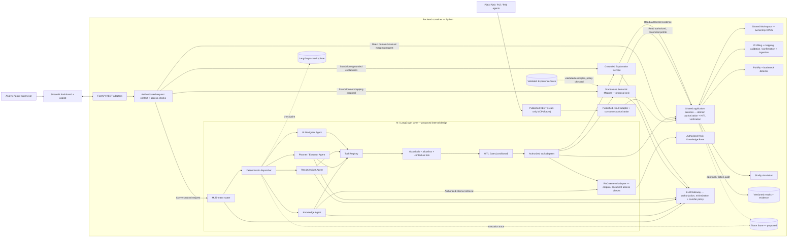
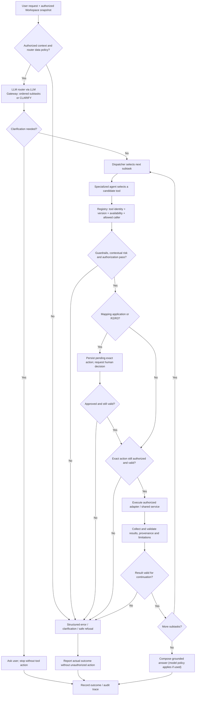

# P05 — AI/Agentic Layer Architecture (Static and Dynamic Views)

> **Status:** WORKING DESIGN PROPOSAL — group review required.  
> **Related task:** [TASK-07, issue #12](https://github.com/ArturRembas/p05-bottleneck-detection/issues/12).  
> **Reference date:** 26 November 2026 (cross-component review alignment).  
> **Relationship to TASK-06:** This document describes the *components, state and interaction flows*. The candidate capabilities, API boundaries and risk tiers are inventoried separately in [AI_API_REQUIREMENTS.md (PR #13)](https://github.com/ArturRembas/p05-bottleneck-detection/pull/13). PR #13 was merged into `master` on 25 November 2026 as a working requirements baseline; its proposed risk tiers, interface extensions and implementation choices still require collective agreement. The remaining requirements consolidation is tracked in [issue #21](https://github.com/ArturRembas/p05-bottleneck-detection/issues/21), in coordination with TASK-03, TASK-04, TASK-05 and TASK-07.

## 1. Purpose, scope and decision status

The P05 agentic layer assists users in interpreting deterministic bottleneck findings, understanding authorized operational documentation, proposing semantic mappings, and interacting with the P05 application through governed tools. It does not replace deterministic event-log processing, bottleneck detection or SimPy calculations.

This specification is an **M1 design baseline for review**, not evidence that any of its agentic workflows have been implemented or tested. It describes the full target architecture while distinguishing the smaller proposed M2 prototype subset.

### 1.1 Decision/status register for this document

| Item | Status at this baseline | Basis / qualification |
|---|---|---|
| Python, FastAPI backend, Streamlit UI, two-container Docker Compose deployment | **Group-approved architecture**, as reported by project scope/checkpoint | Backend modules are not separate microservices. |
| LangGraph-based router/agents, RAG Knowledge Base, separate validated Experience Store | **Group-approved architecture**, internal behavior still under review | See project scope and 6 November presentation. |
| OpenAPI 3.1 and read-only MCP integration | **Group-approved integration direction** | Exact endpoint contracts/permissions remain to be agreed. |
| Multi-intent router, deterministic dispatcher, four specialized agents, template-first Planner | **Luca's layer-level design**, pending formal group/decision-register confirmation | Do not label the four-agent decomposition as separately ratified. |
| Tool Registry, Guardrails, R0–R3 tiers, HITL Gate, LLM Gateway, Trace Store | **Luca's layer-level design**; details proposed | Tool discovery is never automatic authorization. |
| Backend Workspace ownership and Streamlit synchronization | **Open** | Recorded as OPEN-25 in the working context; no final contract assumed. |
| LangGraph pause/resume exposed through Streamlit | **Proposed implementation pattern, unverified in P05** | Requires an integration prototype and durable state/audit policy. |
| Exact model/provider, database, RAG corpus, Experience Store policy | **Open or provisional** | No provider selection or persistence technology is locked by this document. |
| Agent-facing operation inventory | **Merged working requirements baseline — TASK-06 / PR #13** | Its names and risk assignments are not production API commitments. |
| Canonical event log and mapping contract (SC-01–SC-08) | **Merged working domain specification — PR #15** | The specification is on `master`; merging does not by itself ratify every SC proposal or establish runtime ingestion. |
| Detector baseline and admissible evidence (DB-01–DB-07) | **Reviewed domain design proposal — PR #16** | Peer-approved, not yet merged at this reference date; collective ratification and implementation remain separate. |
| Revised OpenAPI 3.1 contract (v0.2.0) | **Working contract candidate — PR #10, `5707c99`** | Peer review ongoing; Luca's approval is limited to the M1 scaffold. Payloads are not backward compatible with earlier v0.2.0 drafts; versioning and consumer agreement remain open. |

The group decision register, SRS v0.2 and consolidated Chat 02 use cases still require reconciliation before final approval. This document assigns **no invented decision IDs**.

### 1.2 Architectural invariants

1. **No LLM calculations:** metrics, graph structure, ranks and simulation outputs come from deterministic services. AI statements must reference their source evidence and limitations.
2. **Mandatory mapping confirmation:** neither an AI-assisted nor a manual mapping can become an applied mapping without an authenticated human decision on the exact source and mapping revision before full ingestion.
3. **Trusted enforcement:** R2/R3 actions and external publication require server-side authorization, an exact-action human decision and an auditable record. An agent never self-approves.
4. **Separated result categories:** measured/derived/unavailable deterministic facts, AI hypotheses/explanations and simulated estimates remain distinguishable.
5. **Independent deterministic path:** ingestion/analysis services must remain usable with manual mapping, independently of the LLM, RAG, SimPy and agentic router; failure of an AI feature must not fabricate a result or silently run a pending action.
6. **Privacy and data lineage:** only authorized, minimized/pseudonymized profiles or evidence are sent to external model providers; mock/synthetic data are clearly labeled.
7. **Single application-service boundary:** dashboard REST adapters and internal agentic adapters use the same reviewed backend application services where applicable. Transport adapters do not own domain logic; internal calls do not bypass trusted authorization or HITL checks. UI-specific actions or RAG adapters need not each be a REST endpoint.
8. **Evidence preservation:** agents must preserve deterministic target semantics, evidence categories, ranking groups, support, coverage and limitations under the proposed TASK-05 baseline. Neither an AI explanation nor human review automatically upgrades analytical evidence or establishes a capacity constraint.

### 1.3 Diagram notation and editable sources

The architecture is represented by **two embedded Mermaid diagrams** and **two UML Sequence Diagrams authored in Visual Paradigm 18.1**:

| Section | View | Authoring format | How to inspect |
|---|---|---|---|
| §2 | Static components and dependencies | Embedded Mermaid `flowchart` | Rendered directly in the Markdown document on GitHub |
| §3.1 | Dynamic request routing and execution | Embedded Mermaid `flowchart` | Rendered directly in the Markdown document on GitHub |
| §3.3 | AI-assisted semantic mapping | Visual Paradigm UML Sequence Diagram | Open `IT.1 - AI-assisted Semantic Mapping` in the Visual Paradigm project |
| §3.4 | R2/R3 human-in-the-loop | Visual Paradigm UML Sequence Diagram | Open `IT.1 - HITL` in the Visual Paradigm project |

The two Sequence Diagrams are authored and maintained in **Visual Paradigm 18.1**. Their editable source project, [`P05 - Bottleneck Detection 1.vpp`](diagrams/P05%20-%20Bottleneck%20Detection%201.vpp), is committed on the TASK-07 branch at `docs/diagrams/P05 - Bottleneck Detection 1.vpp`. Reviewers can download the project and open the diagrams by their exact names. Diego independently inspected both sequence models in his [26 November review of commit `6b54b16`](https://github.com/ArturRembas/p05-bottleneck-detection/pull/14#pullrequestreview-6076607788). This establishes review accessibility for that revision, not acceptance of the models: the requested alignment changes in §3.3 and §3.4 remain pending and require re-review after the native models are updated. SVG/PNG exports are optional review aids and are not included. Any shared model or export must be checked for public-repository suitability and consistency with the editable source.

**Additional Visual Paradigm modeling:** a UML Component Diagram has been started locally; the corresponding Activity Diagram remains planned. Neither is included in this repository revision. The two embedded Mermaid diagrams remain the reviewable static and dynamic views for now. When shared, the additional editable models should remain consistent with the Mermaid views. Any older Agent System Use Case Diagram is exploratory, not the authoritative agent inventory or provider selection; the four-agent design and governance boundaries in this specification take precedence for TASK-07 alignment.

The visual models illustrate **proposed behavior**. Their creation does not prove that endpoints, checkpointers, approval services or application workflows are implemented.

## 2. Static view — components and responsibilities

The approved deployment comprises **one backend/system container** (Python modules for FastAPI, ingestion, PM4Py, simulation and AI) and **one Streamlit UI container**. Boxes inside the backend in the diagram are logical responsibilities, *not* new independently deployed services.

**Diagram reading rules:** solid arrows show the proposed primary communication paths; dotted arrows indicate shared context, governance or future/conditional integration. REST adapters authenticate/route requests to the appropriate entry point; shared application services enforce domain authorization and verify exact-action approval before protected operations. Internal tool adapters may invoke those services without an HTTP round trip and without routing the request back through the conversational router. Published-result adapters permit only the authorized published revision and consumer scope. UI-only actions may use a separate authorized UI adapter; this does not grant unrestricted Workspace access. The diagram shows logical responsibilities within the existing backend container, not new deployments or implemented endpoints.

**Policy boundaries:** every direct RAG retrieval is authorized by the retrieval adapter before documents are accessed. Every model invocation (including routing, standalone mapping and grounded explanation) passes through the LLM Gateway's authorized-context and data-transfer checks. These checks apply even outside Tool Registry dispatch; the gateway only receives information allowed for the specific invocation. Direct service calls remain subject to trusted server-side authorization, independent of agent choices. The Semantic Mapper reads an authorized profile and proposes a mapping; it does not apply one. The manual mapping path reaches the same validation and ingestion service without any LLM or LangGraph dependency.

### 2.1 Four specialized agents

| Component | Intent | Main responsibility | Boundaries |
|---|---|---|---|
| **Knowledge Agent** | `INFO` | Answers informational questions using authorized RAG passages with resolvable citations or abstention. | Does not derive process metrics from documents or access unapproved corpora. |
| **Result Analyst Agent** | `DATA-QA` | Reads existing KPIs, variants, rework and candidate bottleneck evidence; prepares grounded explanatory answers. | Read-only tools by default; cannot alter rankings or claim causal proof. |
| **UI Navigator Agent** | `UI-CONTROL` | Translates user requests into validated filters, views and selections. | Reversible R1 actions; exact Streamlit ↔ Workspace contract remains open. |
| **Planner/Executor Agent** | `EXECUTE` | Coordinates predefined Ingestion, Bottleneck analysis, What-if and Output & publish pipelines, with constrained parameter filling; may propose an explicit free plan for requests outside templates. | Never skips risk checks or performs deterministic computation inside the LLM. |

There is **no separate Process Analyst or What-if Agent** in this baseline. The corresponding functions are Planner/Executor workflow domains. Splitting agents later would require a functional/test-based justification, not only a larger number of tool names.

### 2.2 Cross-cutting components and state boundaries

| Responsibility | Role | Separation / unresolved aspect |
|---|---|---|
| **FastAPI REST adapters** | Transport-level request/response validation, authentication and routing to the appropriate authorized entry point. | Not the owner of domain logic; no mandatory HTTP round trip for internal adapters. |
| **Shared application services** | Domain operation orchestration, authorization and trusted verification of exact-action approvals for REST and internal callers. | Deterministic services do not route back through the agentic router; exact API/persistence contracts remain open. |
| **Semantic Mapper** | Optional standalone AI-assisted mapping proposal based on an authorized, minimized profile; reusable from UI or agent workflows. | Not an agent or approval authority; the manual path uses the same deterministic mapping validation and confirmation. |
| **Grounded Explanation Service** | Optional model-backed explanation of authorized deterministic evidence, reusable by agents and the dashboard. | Does not compute or modify metrics, ranks or evidence categories. |
| **Tool Registry** | Stable logical names, typed schemas and contract versions, adapter kind, allowed callers, risk tier, availability and ownership. | Reviewed REST `operationId` values can identify transport bindings; non-REST tools are declared explicitly. Registry inclusion does not grant permission, and human-decision operations are not autonomous agent tools. Detailed mapping, versioning and contextual risk policy remain subject to issue #21. |
| **Guardrails** | Deterministic argument checks, field/value existence, contextual risk evaluation, privacy filtering, evidence checking and bounded error handling. | Fail closed on unsupported requests, unresolved risk or `501`; prompt instructions alone are not sufficient. |
| **HITL Gate** | Holds R2/R3 actions and any mapping application pending an authenticated human decision. | Human approval must be tied to the exact operation, parameters and relevant version. |
| **LLM Gateway** | Centralized provider adaptation, prompt/model versions, timeout/retry, authorized invocation and data-minimization/transfer-policy checks for all model calls. | Reject disallowed data before transfer, including calls made outside the Registry. Model/provider is provisional; changing providers must not change deterministic results. |
| **RAG retrieval adapter and Knowledge Base** | Authorized corpus/document retrieval from indexed technical documentation and operational procedures. | Enforce caller and document scope before retrieval, including direct Knowledge Agent calls. Separate from the Experience Store; retrieval results must carry resolvable source IDs. |
| **Experience Store** | Human-validated examples for few-shot reuse (e.g., corrected column mappings). | Write only under an approved validation/retention policy; not the RAG document corpus. |
| **Trace Store** | Proposed append-only record of requests, decisions, tool calls, sources, errors and approvals. | It is not the same thing as LangGraph checkpoints; exact persistence choice remains open. |
| **LangGraph checkpointer** | Per-thread graph execution state used for resume/recovery. | A durable checkpointer is necessary for recovery across backend restarts; it is not a substitute for audit records. |
| **Shared Workspace** | Active dataset/analysis, mapping revision, selected process element, filters and view. | Backend ownership, lifecycle and Streamlit synchronization remain OPEN; minimal M2 scope is proposed. |
| **Backend analysis repository** | Stores deterministic results/evidence with versions and availability semantics. | Ownership and exact storage contract are outside this task and depend on core/API design. |

## 3. Dynamic view — request routing and tool execution

### 3.1 Normal interaction

The following is a **candidate control-flow model for conversational requests**, not an implemented LangGraph graph. The router produces an ordered list of `{intent, text}` subtasks or requests clarification. The dispatcher is deterministic: it selects the specialized agent and enforces the sequence, passing along authorized results. This view focuses on registered tool execution; internal model and retrieval steps also enforce the policies in §2. Direct UI domain requests and standalone/manual mapping follow the shared application-service path described in §2 and §3.3, without requiring this graph.

**Trust boundary:** every callable action, including a nested or agent-generated call, must pass through policy enforcement. Direct RAG and model calls are subject to the corresponding retrieval/Gateway checks in §2, including before routing and answer composition. An R0 tool is still subject to data access controls; a cloud LLM invocation is additionally subject to the data-transfer policy. UI confirmation is not sufficient by itself: the backend validates the authorized actor and exact request before the side effect. Unresolved contextual risk or stale approval prevents execution.

**Atomicity:** a compound request may finish some R0 reads before an R2/R3 step pauses or fails. It must expose its actual partial completion and never claim that the entire workflow executed successfully.

### 3.2 Workflow templates under Planner/Executor

| Template | Typical steps | Expected human boundary |
|---|---|---|
| Ingestion | Profile log → propose mapping or accept manual draft → validate/show/correct mapping → confirm exact revision → separately authorize ingestion → deterministic ingestion | Mapping confirmation and ingestion authorization are distinct trusted scopes; neither path bypasses shared application services. |
| Bottleneck analysis | Select approved dataset/mapping → deterministic discovery/detection → read evidence → optional AI explanation | Only if a particular operation is costly/persistent; explanation does not change metrics. |
| What-if | Propose countermeasures → validate scenario assumptions → request SimPy simulation → compare deterministic/simulated evidence | Simulation R2 before execution. |
| Output & publish | Assemble/read results → prepare artifact → request publication → retrieve published revision | Report/export classification open; external publication R3. |

### 3.3 Sequence — AI-assisted semantic mapping (UC02)

The model sees **only an authorized, minimized/pseudonymized profile and bounded samples**. A suggested mapping has no operational effect until a human confirms the exact validated revision. A rejection does not trigger ingestion.

**Standalone workflow and manual fallback:** Streamlit invokes the profiling service through REST adapters. The user can request an AI-assisted proposal from the standalone Semantic Mapper or define a mapping manually, including when the LLM is unavailable. Neither path requires a conversational LangGraph session. The Planner/Executor can invoke the same logical services through authorized tool adapters. Both paths converge on deterministic mapping validation, human review and trusted confirmation, followed by authorized normalization and capability assessment. The manual path never bypasses validation or human confirmation.

**Visual Paradigm reference:** Open the [editable Visual Paradigm project](diagrams/P05%20-%20Bottleneck%20Detection%201.vpp) and select the UML Sequence Diagram **`IT.1 - AI-assisted Semantic Mapping`**.

**Diagram 3.3 — Intended interaction:** deterministic profiling, bounded AI mapping proposal, explicit human confirmation/correction, and guarded deterministic ingestion. The diagram is **not embedded** in this Markdown document; the Visual Paradigm project is required to view it.

**Scope clarification:** the Visual Paradigm diagram labels a possible input as `CSV/XES/OCEL`. This is an illustrative target-format label, **not evidence of approved OCEL ingestion**: the current OpenAPI v0.2 scaffold accepts CSV/XES, and the scope of OCEL support remains open. The implemented behavior must follow the reviewed ingestion contract and the group-approved format scope.

**Approval scope:** the revised TASK-04 contract separates mapping confirmation from authorization to execute ingestion. `AnalysisRequest` carries both `approval_ref` and `ingestion_authorization_ref`; the backend must independently verify each reference against the exact dataset, mapping revision and intended operation. A mapping confirmation alone never authorizes or triggers ingestion. A single user interaction may collect both decisions only if the backend records and verifies their distinct scopes. These are design requirements, not implemented authorization services.

**Canonical mapping contract (TASK-03, PR #15 merged):** confirmation is bound to the exact source identity (including its checksum), mapping identity and revision. The backend verifies the trusted confirmation before applying declarative deterministic rules. Modification creates a distinguishable revision that must be validated and explicitly confirmed; rejection yields no approved revision and no ingestion. Changes to source bytes or mapping rules invalidate the applicable confirmation for the changed source/revision, without erasing historical records. AI proposal metadata remains distinguishable from the deterministic mapping contract. SC-01–SC-08 remain subject to collective ratification.

**Experience Store (conditional side path):** an approved correction *may* yield a privacy-minimized candidate training example after an additional validation/retention policy check. It is not written automatically merely because a user pressed Confirm; its exact policy remains open. Previously validated examples may inform a new proposal but never replace confirmation of the current source and mapping revision. This does not affect the core mapping approval.

**Revised staged REST contract (TASK-04):** the following operations are declared in [PR #10 at commit `5707c99`](https://github.com/ArturRembas/p05-bottleneck-detection/blob/5707c99560b0212c56892c964fb251c57d3e2211/api/main.py), not yet merged into `master` at this reference date.

| Stage | REST operation / stable `operationId` | Contract boundary |
|---|---|---|
| Upload / profiling | `POST /api/v1/datasets/upload` — `upload_dataset` | Multipart CSV/XES; declares `DatasetProfile` with `dataset_id`, `input_sha256`, format, `profile_ref` and structural attributes. |
| Proposal | `POST /api/v1/datasets/{dataset_id}/mapping/propose` — `propose_semantic_mapping` | References an already stored TASK-03 draft via the `mapping_document_ref` query parameter; declares `MappingProposal`. Does not itself define AI generation or draft creation/storage. |
| Human confirmation | `POST /api/v1/datasets/{dataset_id}/mapping/confirm` — `confirm_semantic_mapping` | Accepts `MappingRevision`; declares `MappingConfirmation` with trusted approval/actor/time references. Human-only decision; not self-confirmation by an agent. |
| Analysis | `POST /api/v1/analyses` — `create_analysis` | Accepts `AnalysisRequest` with exact mapping/source identity and separate `approval_ref` and `ingestion_authorization_ref`; declares `AnalysisResultPayload`. |

All four business endpoints remain scaffold operations returning structured HTTP `501` after applicable request validation. The logical standalone Semantic Mapper and manual draft path remain independent of LangGraph. Draft creation/storage, AI generation, selector validation, correction/rejection transport and trusted authorization services are deferred; the current REST models do not directly encode all lifecycle transitions. No new endpoint is assumed for these missing capabilities. The proposed full lifecycle remains a design target, not a claim about implemented functionality.

**Native model alignment pending:** update `IT.1 - AI-assisted Semantic Mapping` to show the Streamlit → FastAPI REST adapter → authorized application-service boundary (or explicitly abstract transport), the independent AI/manual draft paths converging on deterministic validation, distinct confirm/modify/reject outcomes, separate mapping and ingestion approval scopes, and CSV/XES-only initial scope. No ingestion may occur for a rejected, invalid or stale revision. The committed native model has been independently inspected but has not yet been updated to reflect these changes.

### 3.4 Sequence — an R2/R3 request through LangGraph and Streamlit (proposed)

**Visual Paradigm reference:** Open the [editable Visual Paradigm project](diagrams/P05%20-%20Bottleneck%20Detection%201.vpp) and select the UML Sequence Diagram **`IT.1 - HITL`**.

**Diagram 3.4 — Intended interaction:** authenticated request, policy validation, graph interruption/checkpoint, human decision, revalidation, and outcome trace. The diagram is **not embedded** in this Markdown document; the Visual Paradigm project is required to view it.

**Trusted execution boundary:** before a guarded side effect, the Domain Service / Shared Application Services must perform the final server-side authorization check against the authenticated actor, exact operation, parameters, dataset or result revision and applicable approval scope. The same check applies to REST and internal agentic callers. Resume alone is not authorization. Rejected, expired, modified or stale pending actions must become non-executable; changed actions require revalidation and a new applicable decision. Invalidation must not erase the audit record. The native `IT.1 - HITL` model still needs to represent this final check and the invalidation paths explicitly.

**Important LangGraph qualification:** `interrupt()` and `Command(resume=...)` are proposed pause/resume patterns, not an execution-once guarantee. A working implementation must account for node re-execution on resume, idempotent side effects, durable checkpointing, thread identity, timeouts and duplicate submissions. Execution-once behavior is a design requirement to be validated during implementation. These behaviors have **not** been tested in P05. PR #10 does not define the general pending-action approval/resumption or persistence interface.

### 3.5 Other interactions (described now; detailed sequences later)

- **RAG / UC01:** authorized user question → Knowledge Agent → filtered document retrieval → cited passages → LLM response with resolvable citations; abstain if the corpus lacks support. Experience Store is not automatically queried as a general knowledge corpus.
- **Data question / UC05:** selected analysis or node from Workspace → Result Analyst → R0 deterministic evidence retrieval → grounded explanation preserving the typed target, metric semantics, evidence category, ranking group, support, coverage and limitations. Completion-to-completion gaps cannot be labeled measured queue waits.
- **Analysis / UC04:** Planner/Executor requests deterministic analysis through shared application services; `detect_bottlenecks` does not ask the LLM to compute a ranking. The optional explanation is a separate AI result; it cannot recompute or promote deterministic findings.
- **What-if / UC09:** a countermeasure suggestion is an AI hypothesis; a typed, approved R2 scenario is passed to SimPy; outputs are labeled simulated estimates, never observed improvements.
- **External publish / UC11–UC13:** human approves a specific immutable revision (R3); only explicitly permitted/published content becomes visible to external REST/MCP consumers. An internal R0 permission does not automatically authorize external access. PR #10 declares separate `approve_countermeasure` and `publish_analysis_results` operations, the latter binding publication approval to the analysis ID, `result_revision` and explicit consumer set. Both remain scaffolds; the authorized external read interface is deferred.

**Evidence categories (proposed TASK-05, PR #16):** L1 — Delay Hotspot refers to observed inter-event gaps; L2 — Queue Evidence Candidate requires observed, correlated queue-entry/service-start evidence; L3 — Capacity Bottleneck Hypothesis requires additional corroborating capacity and throughput evidence and is not automatically emitted by the initial detector. These are neither severity levels nor confidence probabilities nor automatic promotion stages. L1 and L2 may coexist; neither alone establishes L3. Agents preserve independent ranking groups and disclose support, coverage, temporal semantics and abstention; human review or simulated estimates do not themselves upgrade evidence. Detailed detector rules remain in TASK-05.

**Evidence contract alignment:** the revised TASK-04 candidate represents structured primary metrics in seconds, distinct ranking states and observation coverage, typed targets, and L3 as reserved rather than an emitted initial finding. `AnalysisResultPayload` provides `result_revision` and report-local evidence records; supplied references for KPIs, candidates and AI interpretations must resolve within that report. Empty evidence lists are accepted for the M1 scaffold, not as sufficient grounding for future factual explanations. The Result Analyst and Grounded Explanation Service should use a single authorized revision-bound full report as the initial authoritative snapshot, abstaining from unsupported factual claims. Revision consistency across individual GET operations, completeness/artifact resolution of deterministic evidence and separate simulation provenance remain follow-up contract work under issue #21; no new API is assumed.

These flows are candidates for detailed diagrams in subsequent increments if their necessary API and Workspace contracts have been agreed.

## 4. Failure handling, privacy and traceability

| Case | Required behavior / design invariant |
|---|---|
| LLM service unavailable | Preserve manual/deterministic ingestion and analysis; AI-only features return explicit unavailability. Pending actions do not execute automatically. |
| API endpoint returns `501` or evidence unavailable | Return structured unavailable information; do not substitute mock results or infer a missing KPI. |
| Invalid tool arguments / unknown activity | Guardrails reject, optionally ask for clarification; bounded retries must not weaken schema validation. |
| Router uncertainty or ambiguous multi-intent request | Use `CLARIFY` before consequential action. |
| Human rejects or edits a proposed action | Invalidate the original pending action for execution while preserving audit history. Edited parameters require revalidation and renewed applicable approval. Modified mappings require confirmation of the exact new revision. |
| Approval/retry/Streamlit rerun | Bind approval to actor + exact parameters + dataset/result revision; verify at the Domain Service boundary. Stale or expired pending actions cannot execute. Idempotency and prevention of duplicate side effects require implementation tests. |
| Sensitive information in prompts/profiles | Enforce allowed-corpus/scope, minimization and pseudonymization before external transfer, with audit of applicable policy. |
| Explanation includes numerical claims | Check against resolvable deterministic or simulated evidence; label source type and limitations. A repeated LLM call is not proof of correctness. |
| Unsupported evidence interpretation | Reject or correct claims that convert observed gaps into queue waits, confuse ranking with severity, or promote evidence categories without additional validated evidence. |
| Empty or unsupported detector findings | Distinguish no positive signal, insufficient support, partial/unknown coverage and unavailable evidence or software capability. Do not infer absence of a capacity bottleneck from an empty list. |
| Unapproved external read | Reject even if the underlying internal GET operation is R0; publication authorization and consumer scopes apply separately. |

**Minimum trace content (proposed):** request/actor reference, task sequence, tool schema/versions, relevant dataset IDs or hashes and mapping revisions, tool call outcome, referenced evidence and applicable detector rule/version/configuration, LLM/prompt version, approval decision and final action/result status. Avoid storing unrestricted raw production logs, credentials or sensitive data in model traces.

**State separation:** (1) Workspace = shared application context; (2) LangGraph checkpoint = resumable per-thread execution state; (3) Trace Store = durable audit; (4) Experience Store = validated reusable examples; (5) RAG Knowledge Base = authorized source documents. These are logically distinct even if future persistence choices reuse infrastructure.

## 5. Proposed M2 slice and deferred design

The agentic working baseline proposes **AI mapping with human confirmation, RAG and grounded bottleneck explanations** in Prototype v1 (M2). `docs/MILESTONES.md` identifies the M2 AI subset as subject to agreement and lists grounded AI/RAG among proposed M3 exit evidence. Reconcile the detailed allocation with the group roadmap and decision register; the following is a **capacity-conscious proposal**, not a new group-approved commitment:

1. Provide a standalone AI mapping proposal based on a minimized deterministic profile, with manual fallback and an actual human confirmation boundary before ingestion in both paths.
2. Consume real or explicitly synthetic-labeled deterministic bottleneck evidence through the API; generate a cited explanation without altering calculations.
3. Demonstrate bounded authorized RAG with citations/abstention.
4. Demonstrate one minimal LangGraph route with a small reviewed read-only Tool Registry, validation and traceability.
5. Prototype interruption/resumption for one guarded operation, with explicit tests against reruns, rejection and duplicate submission.

Defer **full natural-language UI control, arbitrary planning, iterative what-if orchestration, external publication and MCP exposure** to M3+ unless the group changes scope. SimPy remains a separate deterministic/simulation capability and may be tested independently of an agent. Deferral of full external publication or MCP implementation does not remove the approved project-level interoperability objectives or the need for a machine-readable output within the agreed prototype scope.

## 6. Outstanding decisions and review evidence

### 6.1 Open questions

- **Workspace:** Who owns current selection, analysis, filters and mapping revisions? How are backend and Streamlit session state synchronized (OPEN-25)?
- **HITL:** Which API owns pending decisions, identity verification, action/version binding, expiration and audit? How is a paused thread resumed safely after Streamlit reruns?
- **Tool contracts:** Which logical tools map to reviewed OpenAPI `operationId` values, and which are independent UI/RAG/LLM adapters? How are stable identifiers, contract changes and contextual risk rules versioned? How are the canonical mapping, evidence categories, ranking scopes, support/coverage and evidence references represented without semantic loss?
- **RAG:** Which documents are authorized, how are citations resolved, and what constitutes a justified abstention (OPEN-08)?
- **Experience Store:** Who validates corrections and governs retention/deletion before reuse (OPEN-16)?
- **Persistence and security:** What data must persist, for how long, and with which access controls (OPEN-10, OPEN-19)?
- **Provider/privacy:** Which runtime and permitted off-premise data classes have been approved (OPEN-09)?
- **M2 cut:** Which agentic use cases and operation subsets are explicitly in Prototype v1, and what baseline/acceptance criteria will verify them?

### 6.2 TASK-07 review checklist

- [ ] Static diagram uses the approved Streamlit + FastAPI two-container boundary and four proposed specialized agents, distinguishing REST adapters from shared application services and showing RAG/LLM policy enforcement, without introducing unsupported microservices.
- [ ] Common dynamic flow includes CLARIFY, deterministic dispatch, Registry/Guardrails and a conditional HITL Gate.
- [ ] Standalone/manual mapping and the mapping sequence prevent ingestion before exact-source/revision confirmation and separate ingestion authorization; verify native model consistency and correction/rejection paths.
- [ ] R2/R3 sequence distinguishes UI confirmation from final Domain Service authorization, graph resume, checkpoint and audit; verify invalidation of rejected, modified or stale actions.
- [ ] The repository includes `docs/diagrams/P05 - Bottleneck Detection 1.vpp`; its contents and metadata are appropriate for a public repository.
- [x] Both original Visual Paradigm Sequence Diagrams independently inspected by Diego at `6b54b16` (26 November review); accessibility established for that revision.
- [ ] Updated native sequence models independently re-reviewed for the requested alignment changes. Editable source retained; any SVG/PNG exports are optional review aids and must match the source.
- [ ] Knowledge Base, Experience Store, Workspace, checkpointer, Trace Store and analysis repository have explicit distinct responsibilities.
- [ ] RAG, evidence-grounded explanations, simulation and external publication are identified with their safety boundaries; evidence categories, ranking scope and abstention are preserved.
- [ ] Approved decisions, Luca's design decisions, proposals and open questions are not conflated.
- [ ] Another team member reviews the document and applicable decisions are recorded in the official register.

**Verification appropriate to this task:** GitHub should render the **two embedded Mermaid flowcharts** (§2 and §3.1). The UML Sequence Diagrams (§3.3 and §3.4) are referenced by their exact Visual Paradigm names, not embedded. Diego's review establishes inspection of the original committed models; the revised native models still require independent review after correction. The Component and Activity Diagram models are additional follow-up artifacts; verify their correspondence with Mermaid when shared. Run `git diff --check` in a local clone and review terminology against PR #10 at the cited commit, the merged TASK-06/TASK-03 working baselines and the proposed TASK-05 detector contract. No runtime LangGraph, Streamlit, API or simulation test result is claimed by these design artifacts.

## References

- [Visual Paradigm source project — TASK-07](diagrams/P05%20-%20Bottleneck%20Detection%201.vpp) (committed on the TASK-07 branch)

- [TASK-07 — issue #12](https://github.com/ArturRembas/p05-bottleneck-detection/issues/12)
- [TASK-06 — issue #11](https://github.com/ArturRembas/p05-bottleneck-detection/issues/11)
- [PR #13 — AI API Requirements (merged working baseline)](https://github.com/ArturRembas/p05-bottleneck-detection/pull/13)
- [AI_API_REQUIREMENTS.md — merged baseline](https://github.com/ArturRembas/p05-bottleneck-detection/blob/19fa74d8748f025799405d4bf17343a541d5f0d8/docs/AI_API_REQUIREMENTS.md)
- [PR #15 — Canonical event-log and mapping contract (merged working specification)](https://github.com/ArturRembas/p05-bottleneck-detection/pull/15)
- [PR #16 — Detector baseline and admissible evidence levels (reviewed proposal)](https://github.com/ArturRembas/p05-bottleneck-detection/pull/16)
- [PR #10 — Revised OpenAPI contract (candidate under review)](https://github.com/ArturRembas/p05-bottleneck-detection/pull/10)
- [TASK-04 API alignment note at `5707c99`](https://github.com/ArturRembas/p05-bottleneck-detection/blob/5707c99560b0212c56892c964fb251c57d3e2211/docs/API_ALIGNMENT_M1.md)
- [Issue #21 — Agent-facing requirements consolidation](https://github.com/ArturRembas/p05-bottleneck-detection/issues/21)
- [TASK-07 independent sequence-model review](https://github.com/ArturRembas/p05-bottleneck-detection/pull/14#pullrequestreview-6076607788)
- [P05 working architecture on master](https://github.com/ArturRembas/p05-bottleneck-detection/blob/master/docs/ARCHITECTURE.md)
- [Project scope and decision status](https://github.com/ArturRembas/p05-bottleneck-detection/blob/master/docs/PROJECT_SCOPE.md)
- [Use-case catalogue](https://github.com/ArturRembas/p05-bottleneck-detection/blob/master/docs/USE_CASE_CATALOG.md)
- [Milestones and proposed exit evidence](https://github.com/ArturRembas/p05-bottleneck-detection/blob/master/docs/MILESTONES.md)
- Local context `02_CONTESTO_AI_Layer_P05.md` §8 (19 November 2026), superseding incompatible React/CopilotKit/AG-UI elements in `05_Architettura_Agentica_P05_28-10.md`.
- [LangGraph — Interrupts](https://docs.langchain.com/oss/python/langgraph/interrupts)
- [LangGraph — Persistence](https://docs.langchain.com/oss/python/langgraph/persistence)
