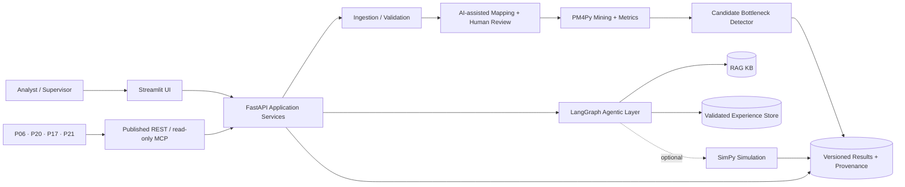
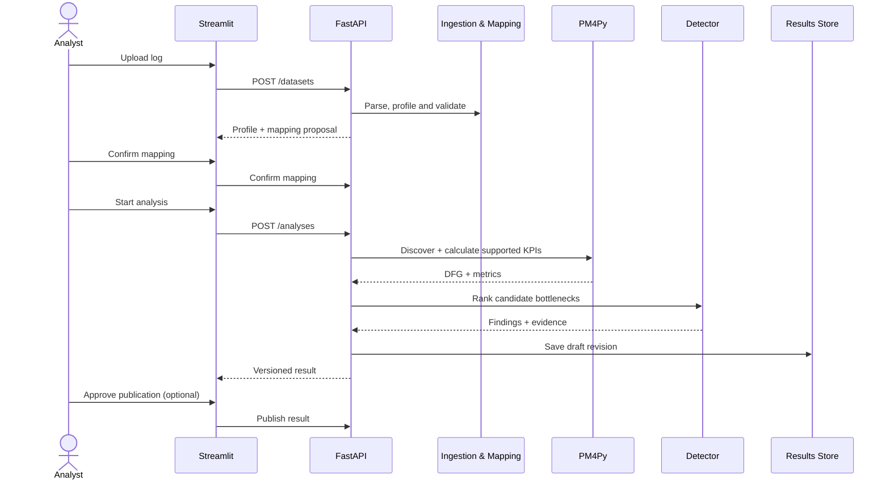

# Architecture — Working Design

**Status:** Component architecture approved in principle; interfaces and many behaviors remain proposals.

All boxes inside the backend represent **Python modules**, not individual microservices. Approved deployment targets are two containers: Streamlit and the core/backend, orchestrated via Docker Compose.

## Source and result boundaries

1. Validation and normalization never silently discard events without documenting the policy.
2. AI may **propose** mappings; a human confirms the final mapping before analysis.
3. PM4Py produces reproducible process representations and measurements.
4. The detector produces candidate findings with evidence, support counts, limitations and rule versions.
5. AI interpretation cannot overwrite measured KPIs or state conjectures as proven causes.
6. SimPy outcomes are labeled as model-dependent estimates, not measured plant outcomes.
7. External consumers can retrieve only explicitly published, authorization-checked results.

## Timing vocabulary

- `observed_inter_event_gap`: time between consecutive recorded events in the same case; **not automatically queue wait**.
- `processing_duration`: paired activity finish minus start when lifecycle/instance evidence exists.
- `queue_wait`: service start minus observed queue arrival when those signals exist.
- `queue_length`: measured or reconstructable occupancy only when transitions support it.
- `case_observed_span`: difference between first and last observed case events; may be shorter than true end-to-end lead time.

For OCEL, object-type/case projection must be explicit and any information loss disclosed.

## End-to-end interaction (proposal)

## Dependencies

The deterministic `Ingestion → Mining → Detection` path must not require LLM/RAG/SimPy availability. The semantic mapper may use a separate LLM adapter, avoiding a circular call into the downstream AI explanation agent.
