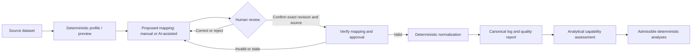

# P05 — Canonical Event-Log Schema and Mapping Contract

| Document control | Value |
| --- | --- |
| Project | P05 — Bottleneck Detection in Processes |
| Version | `0.1.0` |
| Date | 2026-11-24 |
| Status | **Draft for group review — proposed normative baseline** |
| Work item | [TASK-03 — Issue #3](https://github.com/ArturRembas/p05-bottleneck-detection/issues/3) |
| Milestone | M1 — Architecture & Design |
| Repository baseline reviewed | `master` at `ba11a17fd5cf2c8e1c1f2ac39d4287c27186dc38` |
| Related work | TASK-04 (#6), TASK-05 (#7), PRs #8, #9, #10, #13 and #14 |

## 1. Purpose and scope

This specification defines the minimum shared input contract for the P05 deterministic process-mining core. Its purpose is to ensure that ingestion, process discovery, performance analysis, candidate bottleneck detection, the REST interface and AI-assisted semantic mapping use consistent event-log semantics.

The contract separates **observations recorded in the source log**, **quantities deterministically derived from those observations**, **AI-generated interpretations** and **simulation estimates**. A long interval or activity duration alone is not proof of a queue, a capacity bottleneck or a causal relationship.

This document defines:

- the canonical case-centric representation and its required and optional fields;
- event granularity, lifecycle, temporal semantics, resource identifiers and ordering;
- the minimum information required to describe and confirm a source-to-canonical mapping;
- the proposed CSV/XES mapping scope and OCEL limitations;
- the evidence prerequisites for analytical capabilities, including explicit unavailability;
- validation rules, illustrative examples and review criteria.

It does **not** implement ingestion, prescribe an HTTP endpoint, establish detector thresholds, define agent prompts or orchestration, introduce persistence technology, or ratify a particular M2 feature set. Machine-readable JSON Schemas and separately maintained test fixtures will follow this specification after review. Examples in this document are design-level test oracles, not execution evidence.

**Normative language.** MUST, MUST NOT, SHOULD and MAY express proposed requirements, recommendations and permitted behavior within this draft. They become binding project requirements only when the relevant design decisions are accepted by the group. A document version is not evidence of approval, implementation or successful testing.

## 2. Design basis and decision status

### 2.1 Established project direction

The official P05 assignment requires reconstruction of observed processes from operational event logs, analysis of timing and inefficiencies, identification of possible bottlenecks, and interoperable outputs. It does not mandate a specific canonical column vocabulary or require that every source contain the information needed for every analytical capability.

The approved project direction, summarized in the decision register and `docs/PROJECT_SCOPE.md`, includes Python/Pandas/PM4Py, AI-assisted semantic mapping with human confirmation, separation of deterministic computation from AI interpretations, a modular backend, and REST/MCP interoperability. CSV, XES and OCEL are architectural input objectives; the extent of native OCEL support in the initial release remains open.

The SRS v0.2 (12 November 2026) records the relevant use-case catalogue and proposed behavioral specifications. Its detailed acceptance criteria and release assignments are not treated here as a formally ratified SRS baseline.

### 2.2 Proposed decisions for TASK-03

The following local identifiers refer to **design proposals awaiting group review**. They are not replacements for decision-register entries.

| ID | Decision | Proposed baseline |
| --- | --- | --- |
| SC-01 | Canonical model | Case-centric event observations, with metadata and a confirmed mapping reference. |
| SC-02 | Required source information | Non-empty `case_id`, `activity`, valid `timestamp`. |
| SC-03 | Granularity and optional data | Preserve event observations; derive activity occurrences only from explicit semantic and correlation rules. |
| SC-04 | Temporal representation | Timezone-aware UTC instants; declared timestamp meaning; durations in seconds. |
| SC-05 | Quality and ordering | Strict mandatory-field validation; reproducible ordering; explicit limitations; no silent correction or deletion. |
| SC-06 | Mapping governance | Versioned, deterministic, source-bound mapping with trusted human confirmation. |
| SC-07 | Analytical capabilities | Evidence-dependent availability; explicit partial/unavailable states. |
| SC-08 | Initial format scope | CSV/XES case-centric mapping; native OCEL and object-centric analytics deferred. |

The proposal resolves the minimum internal design needed by TASK-03. It does not change the approved application architecture or the existing exchange contract drafts.

### 2.3 Use-case traceability

| Use cases | Contribution of this specification |
| --- | --- |
| D01–D02 | Input format assumptions, source fields and profiling prerequisites. |
| D03–D04 | Confirmed mapping, normalization, validation and diagnostic rules. |
| D05 | Evidence-dependent analytical capability assessment. |
| D09–D11 | Case grouping, ordering, activity sequences and observed repetitions. |
| D13–D15 | Timing semantics and admissibility of performance and queue analyses. |
| D16 | Provenance, revisions, limitations and reproducible interpretation. |
| UC02, UC03 (internal alternative of UC02) | Mapping proposal, confirmation and safe reuse of previous mapping knowledge. |
| UC04 | A validated canonical log and capability assessment as inputs to guided analysis. |

These references establish design traceability, not implementation status or final release allocation.

## 3. Canonical representation (SC-01, SC-02, SC-03)

### 3.1 Logical model

The canonical event log is an internal, case-centric representation produced by applying a confirmed mapping to a particular source dataset. It MUST retain the information required to reproduce that transformation and interpret its results.

```text
Source dataset (CSV or XES)
    + exact confirmed mapping revision
        -> deterministic normalization and validation
        -> canonical event log
            - metadata and provenance
            - normalized event observations
        -> capability assessment
        -> analysis-specific views
        -> deterministic mining and metrics
```

A Pandas DataFrame is a suitable working representation for the event table. A serialization used for documentation, fixtures or internal exchange MAY use JSON. Neither representation prescribes a public REST request body. An adapter to PM4Py MUST apply the appropriate activity, case and timestamp semantics; the raw table MUST NOT be passed indiscriminately to every mining algorithm.

### 3.2 Event granularity

A canonical row represents **one observed event**, not necessarily one completed activity occurrence. An observation MAY carry additional timestamps explicitly associated with the same occurrence. A source with one record per completed activity and a source with separate `start` and `complete` events can therefore both be represented without inventing events or losing their original meaning.

The normalized event log MUST NOT implicitly collapse lifecycle transitions, merge duplicate-looking records, or create synthetic start/completion events. Derived views MAY select or correlate observations, but the selection/correlation policy and excluded records MUST be traceable.

For the initial activity-based discovery path, a confirmed completion view is preferred when the data support it. Otherwise, a homogeneous, explicitly documented event-sequence view MAY be used and labeled accordingly. A mixed lifecycle log with ambiguous occurrence semantics MUST NOT be treated as a sequence of distinct completed activities. Event-level and occurrence-level outputs MUST identify which view they use.

### 3.3 Canonical field definitions

The minimum **source information** is the first three fields. Optional fields remain optional even when needed by particular analytical capabilities. The source-event index is generated by normalization and is not an additional required input column.

| Field | Logical type | Presence | Semantics and constraints |
| --- | --- | --- | --- |
| `case_id` | string | Required | Identifier of one process instance under the declared case notion. Non-null, non-blank; preserve significant characters and leading zeros. |
| `activity` | string | Required | Observed activity or event class. Non-null, non-blank; no automatic synonym merging. |
| `timestamp` | UTC-aware datetime | Required | Instant of the observation, with its meaning declared by the mapping. Not necessarily completion. |
| `event_id` | string | Optional | Source event identifier, unique within the dataset when mapped as such. It identifies an event, not an occurrence. |
| `activity_instance_id` | string | Optional | Identifier linking observations of the same activity occurrence. The correlation key for v0.1.0 is (`case_id`, `activity`, `activity_instance_id`). |
| `lifecycle` | string | Optional | Normalized event lifecycle meaning: `start`, `complete`, `queue_entry`, `other` or `unknown`. Source-specific values MUST be interpreted through explicit mapping rules. |
| `resource_id` | string | Optional | Observed resource association. Its role (e.g. machine, operator, pool) MUST be declared before resource-specific analysis. |
| `start_timestamp` | UTC-aware datetime | Optional | Observed start of service for the associated occurrence. Not a default equal to `timestamp`. |
| `queue_entry` | UTC-aware datetime | Optional | Observed entry into the queue associated with the same service occurrence. Not a default equal to the preceding event timestamp. |
| `source_event_index` | non-negative integer | Generated | Unique zero-based ordinal of the original event in deterministic source traversal, assigned before sorting. Used for source linkage and tie-breaking; not a physical sequence number. |

Missing optional values MUST remain missing (omitted or null in illustrative JSON; missing values in the internal table). Empty optional source values are treated as missing, with diagnostics where relevant. Invalid optional values MUST NOT be carried as if valid typed values; the original source reference and reason for exclusion from normalization/metrics MUST be retained in the quality evidence. Zero is a valid measured duration, not a substitute for missing information.

Additional source attributes MAY be preserved under an explicitly declared mapping or separately referenced source metadata when necessary and authorized. The minimum contract does not define an arbitrary extension model, a full resource ontology or a multi-resource association schema.

### 3.4 Log-level metadata and provenance

The following information MUST be available alongside the normalized event table. The proposed logical field names are independent of the API payload naming and will be formalized in the companion schemas.

| Information | Proposed field | Meaning |
| --- | --- | --- |
| Canonical schema version | `schema_version` | Version of this canonical contract, initially `0.1.0`. |
| Dataset identity | `input_sha256` | SHA-256 of original input bytes, before parsing or transformation. |
| Source format | `source_format` | `csv` or `xes` for the initial supported scope. |
| Case notion | `case_notion` | Declared meaning of a case, e.g. production order or workpiece; no assumed universal notion. |
| Applied mapping | `mapping_id`, `mapping_version` | Exact confirmed mapping revision used for normalization, linked to approval evidence. |
| Time semantics | `timestamp_semantics` | Declared meaning of the primary observation timestamp (Section 4). |
| Source timezone | `source_timezone` | Explicit timezone used for offset-free source timestamps, if applicable. |
| Normalized timezone | `normalized_timezone` | `UTC`. |
| Counts and limitations | Quality report reference or associated report | Input and normalized record counts, invalid/ambiguous fields, view selections, relevant limitations and exclusions. |

Re-normalization with different mapping rules MUST produce distinguishable provenance. The source checksum alone is not an identifier for a particular normalized representation. Storage mechanisms, retention rules and dataset/API identifiers remain separate design decisions.

## 4. Temporal semantics, lifecycle and resources (SC-03, SC-04)

### 4.1 Timestamp meaning and normalization

The mapping MUST explicitly declare `timestamp_semantics` for the primary `timestamp` field. The proposed internal vocabulary is:

| Value | Meaning |
| --- | --- |
| `completion` | Primary timestamps represent observed activity completions. Additional start/queue attributes may also exist. |
| `start` | Primary timestamps represent observed starts. |
| `lifecycle` | The meaning depends on the mapped lifecycle value of each observation. |
| `other_observed` | Another documented observation instant, described in the mapping. |
| `unknown` | The instant is valid but its operational meaning is not established. |

These labels describe the canonical input, not the external API `TimeSemantics` enumeration or the availability of a metric. `unknown` does not imply completion. For `lifecycle`, an absent or unknown transition MUST NOT be silently interpreted as `complete`.

All normalized timestamps MUST be timezone-aware instants expressed in UTC. Textual canonical timestamps SHOULD use ISO 8601 with a `Z` suffix, for example `2026-10-01T08:00:00Z`. Conversion MUST preserve the instant and supported source precision; unsupported precision or parsing assumptions MUST be reported. Durations are elapsed time in seconds, not business hours or shift-adjusted time.

Source timestamps with explicit UTC offsets MUST be converted by their offset. A naive (offset-free) timestamp requires an explicitly confirmed source timezone, preferably an IANA timezone such as `Europe/Rome`. The parser MUST NOT infer the timezone from the developer's machine, container, filename or server locale. Ambiguous date formats require an explicit format rule. Ambiguous or nonexistent local times caused by daylight-saving transitions MUST be rejected or resolved by a documented, confirmed disambiguation rule; there is no implicit DST correction. If required fields use different source timezone or parsing rules, those differences MUST be declared in the confirmed mapping. Complex source-specific conversions outside the implemented rules are unsupported, not guessed.

### 4.2 Activity instances and lifecycle projection

The canonical event model supports two evidence patterns:

1. An observation whose primary timestamp is a confirmed completion, with optional observed start and queue-entry attributes for the same occurrence.
2. Separate lifecycle observations correlated by an explicit occurrence identifier or another documented and reviewed unambiguous rule.

For pattern 2, the presence of a matching `case_id` and `activity` alone is insufficient when an activity can repeat or overlap. In v0.1.0, the proposed safe correlation key is (`case_id`, `activity`, `activity_instance_id`), with at most one unambiguous start and completion (and queue-entry observation when applicable) per simple service occurrence. Duplicate transitions, multiple candidate matches, missing endpoints or inconsistent occurrence identifiers MUST prevent interval derivation for that occurrence until resolved. Other lifecycle models, including suspension/resumption, are not normalized to continuous active service by assumption.

Where both inline timestamps and separate lifecycle observations are supplied for the same occurrence, agreement and provenance MUST be checked before combining evidence; contradictions MUST NOT be silently resolved by selecting one source. A completed-occurrence view MUST avoid double-counting the same occurrence. Completion order is not necessarily execution order or proof of causal precedence in concurrent processes.

### 4.3 Temporal quantities

| Quantity | Definition | Evidential constraint |
| --- | --- | --- |
| Observed inter-event gap | `timestamp(next) - timestamp(current)` within a declared ordered case view | Describes recorded instants; may include service, transport, inactivity or recording delay. |
| Processing/service duration | `complete - start` for the same occurrence | Both endpoints must be observed, correlated and semantically confirmed. Elapsed duration is not necessarily active machine time. |
| Queue waiting time | `service_start - queue_entry` for the same service occurrence | Requires valid observed queue entry and start. The preceding event is not a queue-entry proxy by default. |
| Observed case span | `max(timestamp) - min(timestamp)` within the declared case view | Covers only the observed window; a single observation gives zero span, not zero true lead time. |

Whenever the corresponding endpoints are available, they MUST satisfy `queue_entry <= service_start <= completion`. For a waiting-time calculation only queue entry and service start are necessary; completion is not required if the waiting interval is otherwise well-defined. For processing duration only start and completion are necessary. Equal endpoints can yield zero. Negative durations MUST NOT be clipped to zero, converted to absolute values, or silently discarded. A missing or inconsistent optional endpoint affects the admissibility of dependent analyses, not the existence of the observed event itself.

### 4.4 Resource semantics

A resource identifier MUST NOT be inferred from the activity name. Multiple resources may execute the same activity, and one resource may execute several activities. `resource_id` alone supports attribution or grouping only to the extent justified by its declared role. It does not identify the full resource pool, machine count, shift availability, simultaneous occupancy or production capacity. Resource-level waiting and service measures require a justified association of the relevant intervals with the resource or station. Utilization and capacity claims require additional operational context; their complete model is outside TASK-03.

## 5. Validation and ordering (SC-05)

### 5.1 Quality policy

The initial contract proposes strict validation of required information. Profiling and mapping preview MAY inspect invalid or incomplete sources; full normalization as an analysis-ready log MUST reject invalid mandatory information. Optional data limitations MUST be recorded rather than replaced with invented observations.

| Condition | Required response under this proposal |
| --- | --- |
| Empty or unreadable source; zero event records | Reject analysis-ready normalization. |
| Missing required mapping or absent required source field | Reject; identify the target/source field. |
| Null, empty or whitespace-only required identifier/activity | Reject; preserve significant identifier characters when valid. |
| Unparseable required timestamp; unresolved timezone/DST ambiguity | Reject until the input or mapping is corrected. |
| Absent optional field/value | Preserve missingness; assess dependent capabilities. |
| Invalid optional time or inconsistent interval | Record diagnostic; invalidate affected observation/interval for dependent metrics without silently deleting the canonical event. |
| Unmapped/unknown lifecycle or ambiguous occurrence | Preserve observation and reason; do not derive an unsupported occurrence or interval. |
| Source records out of chronological order | Apply declared deterministic ordering; record the transformation. |
| Equal timestamps within a case | Use source traversal index for reproducibility; flag ordering ambiguity unless an independent authoritative ordering rule is confirmed. |
| Potential duplicates without authoritative identity | Flag; no automatic deduplication. |
| Repeated mapped `event_id` | Reject when it violates the declared event-identity constraint. |
| Missing, rejected, stale or mismatched mapping confirmation | Do not finalize normalization or trigger analysis. |
| Unsupported source format/projection | Reject as unsupported; do not reinterpret it as CSV/XES. |

No mandatory-record exclusion or imputation policy is introduced by this baseline. If a future release permits explicit row exclusion, it requires a reviewed policy, a new confirmed mapping or configuration as appropriate, and traceable counts and source references.

### 5.2 Ordering and ambiguity

`source_event_index` MUST be assigned before sorting: CSV data-record order (excluding the header) or deterministic XES trace/event traversal order. A default reproducible order is ascending `timestamp`, then ascending `source_event_index` within each `case_id`. The order of case groups is immaterial to within-case metrics. The normalization and analysis view MUST preserve the declared case boundaries and MUST NOT join consecutive events across cases.

An approved authoritative source sequence MAY provide additional ordering evidence where applicable; the exact rule MUST be documented, including any inconsistency with temporal order. The default tie-breaker is technical, not evidence that one tied event physically preceded another. DFG edges, variants and related metrics affected by ties MUST carry an ambiguity limitation; a capability assessment MAY be partial or unavailable when the requested interpretation requires an unambiguous order. The same input, mapping and declared ordering rules MUST yield the same ordered view.

### 5.3 Diagnostic information

Validation evidence SHOULD identify the rule, affected canonical field, source event reference where applicable, number of affected records, and consequence (blocking, limitation or informational). It MUST distinguish rejected logs from accepted logs with restricted analyses. It SHOULD avoid echoing sensitive raw values. HTTP status codes and the public error representation belong to TASK-04; this document does not add public error codes.

## 6. Mapping contract and human confirmation (SC-06)

### 6.1 Required mapping information

The mapping defines how to obtain canonical values from a specific source. It is separate from the canonical log and from the API transport representation. A mapping proposal MUST be distinguishable from a confirmed mapping. A human decision MUST bind to the exact source and mapping revision applied by the deterministic normalizer.

| Field | Required content |
| --- | --- |
| `schema_version` | Target canonical schema version. |
| `mapping_id`, `mapping_version` | Stable mapping identity and distinguishable revision (positive integer revision proposed). |
| `input_sha256`, `source_format` | Source identity and format. |
| `case_notion` | Meaning of the selected case identifier. |
| `field_mapping` | Explicit source selectors for required and any mapped optional fields; selector scope distinguishes CSV column, XES trace attribute and XES event attribute. |
| `timestamp_semantics` | Meaning of the primary observation timestamp, with explanatory detail when required. |
| `source_timezone` | Confirmed source timezone for naive timestamps, if applicable; otherwise null/omitted. |
| `transformations` | Declarative deterministic parsing/normalization rules, including relevant format settings, lifecycle value mapping, correlation and field-specific rules. |
| `approval` | Trusted reference to confirmation of this exact mapping revision and dataset, or an explicit non-confirmed state. |

The selector and transformation structures in the examples are proposed representations, to be formalized in the companion schema. Transformations MUST use supported, deterministic operations. Arbitrary executable code generated by an LLM is not part of this mapping contract. Required parsing settings (e.g. CSV encoding, delimiter, quote conventions, timestamp format and null handling) MUST be reproducible through documented defaults or explicit rules. Identity changes, trimming, label normalization or value recoding beyond validation MUST be declared if applied. Identifier validation MUST NOT remove meaningful leading zeros or collapse distinct identifiers. The proposed default missing-value policy treats absent values and empty/whitespace-only source cells as missing; non-empty strings such as `NA`, `NULL` and `nan` MUST NOT be interpreted as missing identifiers merely because a parser uses those tokens by default. Additional missing-value markers require explicit mapping rules.

### 6.2 Confirmation boundary



A manual mapping follows the same confirmation boundary as an AI-assisted mapping. Profiling and preview are permitted before confirmation; no final analysis-ready normalization or full analysis may be triggered on the basis of an unconfirmed proposal. A confirmation is not proof that the data are valid; structural and semantic consistency checks still apply.

Changes to source bytes, selected fields, parsing settings, semantic meaning or transformation rules MUST invalidate confirmation for the changed mapping/source combination. Previously confirmed revisions MUST remain distinguishable from new proposals. Prior mapping experience MAY inform a new proposal, but MUST NOT substitute for confirmation of the new source/revision.

An `approval.status` supplied by a client or an LLM is not trusted proof of human action. The backend MUST verify confirmation from the trusted application context, including the reviewed revision, source identity, actor reference and confirmation time. The approval storage mechanism, authentication design, API operations and agent interaction details are not prescribed by TASK-03.

### 6.3 Separation of responsibilities

The deterministic ingestion/core boundary owns the application of validated mapping rules, normalization and quality/capability evidence. AI may propose mappings and explain ambiguities but cannot change canonical data or self-confirm mappings. API and UI components carry the relevant input, confirmation and evidence through reviewed interfaces. This is a responsibility boundary between modules, not an assignment of exclusive individual ownership.

## 7. Source-format mapping (SC-08)

### 7.1 CSV

CSV headers are source selectors, not semantic declarations. A valid source can use arbitrary column names provided that the confirmed mapping supplies the required fields. The initial path assumes a tabular file with an explicit header and reproducible dialect/encoding rules. Required headers must be unambiguously identifiable; duplicate header names that make selectors ambiguous must be resolved before normalization. Case and event identifiers must be read without numeric coercion.

| Canonical target | Example CSV source |
| --- | --- |
| `case_id` | `Order_ID` |
| `activity` | `Operation` |
| `timestamp` | `Recorded_At` |
| `event_id` | `Event_ID` |
| `activity_instance_id` | `Operation_ID` |
| `lifecycle` | `State` |
| `resource_id` | `Machine` |
| `start_timestamp` | `Start_Time` |
| `queue_entry` | `Queue_Arrival` |

Only the first three targets are required source information. Actual source names, value meanings, timezone and row granularity require confirmation.

### 7.2 XES

The initial mapping concerns case-centric trace/event structure. A trace attribute and an event attribute of the same name are distinct selectors. Typical candidate mappings are:

| Canonical target | XES selector candidate |
| --- | --- |
| `case_id` | Trace-level `concept:name` |
| `activity` | Event-level `concept:name` |
| `timestamp` | Event-level `time:timestamp` |
| `lifecycle` | Event-level `lifecycle:transition` |
| `resource_id` | Event-level `org:resource` |
| `activity_instance_id` | Event-level `concept:instance`, where present and semantically appropriate |
| `event_id`, `start_timestamp`, `queue_entry` | Explicit source attribute or, for temporal endpoints, reviewed correlation of lifecycle observations |

The standard attribute names are mapping candidates, not proof of particular timestamp or resource semantics. A trace identifier MUST identify the selected case notion without unintended collisions between distinct traces. The mapping must not require optional XES extensions in every source. If the selected activity classifier is composite or source-specific, its deterministic construction must be declared or treated as unsupported by the initial implementation. XES start/complete events remain observations until the view/correlation rules in Section 4 are applied. The contract does not implement an XES parser or claim support for every extension or lifecycle convention.

### 7.3 OCEL limitation

Native OCEL/object-centric processing is **outside the initial case-centric contract**. An OCEL event may relate to multiple objects and object types, and a unique case identifier cannot be inferred automatically. A future OCEL adapter would require an explicitly selected object type/case notion, a documented event-object projection and a policy for missing or multiple relationships, duplication and information loss. Any projected log must be evaluated against the canonical semantics and preserve projection provenance. Such an extension requires review; it is not implemented or ratified by this document. This limitation does not remove OCEL from the approved architectural objectives.

## 8. Analytical capability requirements (SC-07)

### 8.1 Availability is an evidence property

The deterministic capability assessment answers whether a requested analysis is admissible from the available, validated information. It MUST consider both structural completeness and semantic suitability, including the selected view, correlation, observation window and quality limitations. It MUST NOT equate the presence of a column with the availability of a valid measure. This extends the principle illustrated by EXP-10 without adopting its code as an official implementation.

| State | Meaning |
| --- | --- |
| `available` | Evidence prerequisites are satisfied for the declared analysis scope and interpretation. |
| `partial` | Prerequisites are satisfied only for an identifiable subset or a restricted interpretation; coverage and limitations must be disclosed. |
| `unavailable` | The requested analysis is not supported by the available evidence or no admissible observations exist. |

The report MUST identify the analysis/capability, status, reason for limitations, relevant evidence or missing prerequisites, eligible observation count and denominator where meaningful, and the analyzed subset/view. Counts use the relevant unit (events, pairs, occurrences, cases or resources), not an interchangeable global count. A partial result MUST NOT be extrapolated to the complete log without a separately stated and justified method. The availability status concerns data evidence, not whether the software capability has been implemented; an implementation must also report its actual operational limitations.

### 8.2 Minimum evidence matrix

| Analysis | Minimum admissible information | Interpretation boundary |
| --- | --- | --- |
| Frequency DFG | Valid case, event/activity class and reproducible order in a declared view | Observed directly-follows relations, not causal dependencies. Distinguish event-level from occurrence-level discovery. |
| Process variants | Ordered case sequences in the same declared view | Observed sequences; ties and incomplete traces limit interpretation. |
| Observed repetitions | Distinguishable repeated activity occurrences for activity-level claims | Repetition is not automatically rework caused by defects. |
| Inter-event gaps | Valid comparable timestamps on consecutive events in a declared ordered case view | Elapsed intervals, not necessarily waiting. Singleton cases provide no adjacent pairs. |
| Observed case span | Valid first/last observed instants within a case view | Observed duration, not necessarily full process lead time. |
| Processing duration | Correlated, semantically valid start/completion endpoints | Elapsed duration for eligible occurrences; active processing may require additional evidence. |
| Queue waiting time | Correlated, semantically valid queue-entry/service-start endpoints | Waiting for the associated service, not inferred from completion gaps. |
| Resource grouping/metrics | Valid resource IDs with declared meaning; valid metric inputs for each requested measure | No implicit assignment or capacity inference from an ID alone. |
| Waiting-time dynamics | Ordered waiting observations and known observation window | Describes observed waiting behavior; does not establish queue occupancy or a persistent capacity bottleneck. |
| Queue length/backlog | Sufficient queue arrival/removal observations or occupancy states, known scope and initial/boundary conditions | A series of completed waits alone may omit outstanding or censored items and is not sufficient to reconstruct general occupancy. |
| Resource utilization | Reliable busy intervals, resource association, available capacity/time window and calendars as needed | Requires a valid denominator and handling of overlap; outside the minimal log. |
| Capacity bottleneck assessment | Evidence relevant to capacity, demand, workload and persistence, according to reviewed TASK-05 criteria | Candidate or hypothesis; no automatic diagnosis from a single duration or positive wait. |

An empty set of candidate findings is not equivalent to an unavailable detector. Likewise, an observed zero waiting time is not equivalent to missing queue-entry data. Numerical KPI status (`measured`, `derived`, `estimated`, `unavailable` in PR #10) is a separate concern from analytical capability status. Deterministically calculated differences between observed endpoints are derived from observations, not simulation estimates. Unsupported numeric measures must not be returned as zero or presented as measured; TASK-04 will define the exact public representation.

## 9. Illustrative examples and design-level validation

All examples are synthetic and intended for specification review. They do not establish accuracy on real manufacturing processes. The expected outcomes below are analytical or validation oracles, not claims that current ingestion or mining code has been executed.

### 9.1 Minimal completion-only CSV

Assume the primary timestamp is explicitly confirmed as an activity completion and that each record denotes a separate completed occurrence.

```csv
case_id,activity,timestamp
P001,Cutting,2026-10-01T08:00:00Z
P001,CNC Milling,2026-10-01T08:30:00Z
P001,Welding,2026-10-01T09:15:00Z
P001,Quality Control,2026-10-01T09:30:00Z
```

Expected: one case, four observations, three DFG edges with frequency 1 each, consecutive observed gaps of 1800, 2700 and 900 seconds, and observed case span of 5400 seconds. Frequency discovery, variants and the listed observed intervals are admissible. Processing duration, actual queue waiting, queue length and resource utilization are unavailable. The 2700-second gap MUST NOT be labeled a 2700-second wait for Welding.

### 9.2 Enriched completion observation

```csv
case_id,activity,timestamp,activity_instance_id,resource_id,start_timestamp,queue_entry
P001,Welding,2026-10-01T09:15:00Z,W01,Welder-1,2026-10-01T09:00:00Z,2026-10-01T08:50:00Z
```

Assume all three instants are explicitly observed for the same occurrence; `resource_id` identifies the executing machine. Expected: service duration 900 seconds, queue waiting time 600 seconds, and one eligible occurrence for each duration. The sample is not sufficient to establish queue length, utilization or a capacity bottleneck. If `queue_entry` were absent, service duration would remain admissible but waiting would become unavailable.

### 9.3 Equivalent paired lifecycle observations

```csv
case_id,activity,timestamp,activity_instance_id,lifecycle
P001,Welding,2026-10-01T08:50:00Z,W01,queue_entry
P001,Welding,2026-10-01T09:00:00Z,W01,start
P001,Welding,2026-10-01T09:15:00Z,W01,complete
```

With a confirmed lifecycle mapping and unambiguous occurrence association, the same 900-second service duration and 600-second wait are admissible. The canonical table has three observed events; a completed-occurrence view has one occurrence, not three repetitions of Welding. General lifecycle pairing support is not asserted to be implemented in M2 merely because its evidential requirements are specified here.

### 9.4 Minimal XES example

```xml
<?xml version="1.0" encoding="UTF-8"?>
<log xmlns="http://www.xes-standard.org/" xes.version="1.0">
  <trace>
    <string key="concept:name" value="P001"/>
    <event>
      <string key="concept:name" value="Cutting"/>
      <date key="time:timestamp" value="2026-10-01T10:00:00+02:00"/>
      <string key="lifecycle:transition" value="complete"/>
    </event>
    <event>
      <string key="concept:name" value="Welding"/>
      <date key="time:timestamp" value="2026-10-01T11:15:00+02:00"/>
      <string key="lifecycle:transition" value="complete"/>
    </event>
  </trace>
</log>
```

Expected under the declared standard selectors and completion semantics: two observations for `P001`, UTC timestamps `08:00:00Z` and `09:15:00Z`, one Cutting-to-Welding DFG edge and an observed gap of 4500 seconds. No processing duration or queue waiting is established. This fragment illustrates the mapping and is not a conformance test of a complete XES implementation.

### 9.5 Mapping and normalized representation

Consider a UTF-8 CSV with LF line endings and the following exact contents (including the final newline):

```csv
Order_ID,Operation,Recorded_At
0007,Cutting,2026-10-01T10:00:00+02:00
```

A possible confirmed-mapping representation is shown below. The approval values are synthetic placeholders for illustration, not authenticated approval evidence. The examples use a SHA-256 computed from the displayed source bytes; the hash identifies the source, not approval authenticity.

```json
{
  "schema_version": "0.1.0",
  "mapping_id": "mapping-example-001",
  "mapping_version": 1,
  "input_sha256": "f172179f3be3ea4fbdcef30731a524bd86c2105cf3d8345eb51c61e4fe5bf633",
  "source_format": "csv",
  "case_notion": "production order",
  "field_mapping": {
    "case_id": {"scope": "csv_column", "name": "Order_ID"},
    "activity": {"scope": "csv_column", "name": "Operation"},
    "timestamp": {"scope": "csv_column", "name": "Recorded_At"}
  },
  "timestamp_semantics": "completion",
  "source_timezone": null,
  "transformations": {
    "csv": {"encoding": "utf-8", "delimiter": ",", "quotechar": "\"", "header": true},
    "timestamp_format": "iso8601",
    "identifier_policy": "preserve_string",
    "null_policy": "empty_or_blank",
    "ordering": "timestamp_then_source_event_index"
  },
  "approval": {
    "status": "confirmed",
    "mapping_id": "mapping-example-001",
    "mapping_version": 1,
    "input_sha256": "f172179f3be3ea4fbdcef30731a524bd86c2105cf3d8345eb51c61e4fe5bf633",
    "actor_ref": "synthetic-reviewer",
    "confirmed_at": "2026-11-24T15:00:00Z",
    "approval_ref": "synthetic-approval-001"
  }
}
```

Illustrative normalized event log:

```json
{
  "metadata": {
    "schema_version": "0.1.0",
    "input_sha256": "f172179f3be3ea4fbdcef30731a524bd86c2105cf3d8345eb51c61e4fe5bf633",
    "source_format": "csv",
    "case_notion": "production order",
    "mapping_id": "mapping-example-001",
    "mapping_version": 1,
    "timestamp_semantics": "completion",
    "source_timezone": null,
    "normalized_timezone": "UTC",
    "quality_report_ref": "synthetic-quality-001"
  },
  "events": [
    {
      "case_id": "0007",
      "activity": "Cutting",
      "timestamp": "2026-10-01T08:00:00Z",
      "source_event_index": 0
    }
  ]
}
```

The associated illustrative quality report would record one input and one normalized event, with no exclusions. The order ID remains `0007`. The offset-bearing timestamp requires no assumed source timezone. The single observed event provides no inter-event gap. Neither example defines an implemented API payload, a persistent storage model or a real approval.

### 9.6 Validation case catalogue

The following stable identifiers can be carried into the future fixture set. All outcomes are proposed expectations, to be verified when the corresponding checks exist.

| ID | Input or condition | Expected outcome |
| --- | --- | --- |
| VC-01 | Minimal confirmed completion-only CSV (9.1) | Accept; observed DFG/gaps available, processing/queue waiting unavailable. |
| VC-02 | Enriched valid occurrence (9.2) | Accept; 900 s service, 600 s waiting; no capacity diagnosis. |
| VC-03 | Correlated lifecycle events (9.3) | Preserve three observations; one completed occurrence and valid intervals if the correlation view is supported. |
| VC-04 | Valid XES trace (9.4) | Preserve trace/event scopes and normalize offsets; expected 4500 s gap. |
| VC-05 | Empty source or missing required source column | Blocking validation failure. |
| VC-06 | Null/blank case or activity; invalid mandatory timestamp | Blocking validation failure; no ready canonical log. |
| VC-07 | Offset-free timestamp without confirmed timezone; DST ambiguity without rule | Blocking temporal validation failure. |
| VC-08 | `2026-10-01T10:00:00+02:00` and `2026-10-01T08:00:00Z` | Same canonical UTC instant; if within one case, a tie may exist. |
| VC-09 | `queue_entry` after valid service start | Keep valid observation; affected wait invalid, not zero; processing unaffected if its own prerequisites hold. |
| VC-10 | Confirmed completion before mapped start | Keep valid primary observation; inconsistent occurrence timing reported; processing invalid. A separately valid queue-entry/start pair requires independent consistency evidence before use. |
| VC-11 | Two equal-time events in a case with no authoritative sequence | Reproducible technical order; ambiguity disclosed; no causal order inferred. |
| VC-12 | Potential duplicate records without event identity | Flag; no automatic deletion. A duplicate declared `event_id` violates the identity constraint and is rejected. |
| VC-13 | Two starts and one completion of same activity with no unambiguous instance association | Do not guess pairing; dependent duration unavailable or partial. |
| VC-14 | Valid single timestamp with unknown meaning | Accept as an observation; event-level gap/discovery only when other prerequisites hold; no automatic completion semantics. |
| VC-15 | Two eligible occurrences, only one valid queue-entry/start pair | Waiting capability partial, coverage 1/2 occurrences, reason disclosed. |
| VC-16 | Proposed/rejected mapping, stale revision, or mismatched source hash | No final normalization/analysis; require valid confirmation. |
| VC-17 | Identifier `0007` | Preserve exact significant string value. |
| VC-18 | Native OCEL input without reviewed projection | Unsupported by initial contract. |
| VC-19 | Valid queue entry equals service start | Derived zero waiting time, distinct from unavailable waiting time. |
| VC-20 | Multiple cases with adjacent timestamps | No DFG transition or gap across case boundaries. |

## 10. Interfaces with other work items

### 10.1 TASK-04 — REST/OpenAPI contract (Issue #6, PR #10)

The canonical schema is an internal input/domain contract, not a replacement for `contracts/draft-v0.1/` or the proposed OpenAPI v0.2 contract in PR #10. The PR #10 code examined declares CSV/XES input, a three-column mapping interface, distinct KPI status and time semantics, capability reporting and source provenance. Its upload operation validates basic request constraints but returns `501` rather than executing the not-yet-integrated analytical engine. These are properties of the reviewed proposal/scaffold, not proof of operational ingestion on `master`.

| Alignment item | Required joint review |
| --- | --- |
| `case_id_col`, `activity_col`, `timestamp_col` | Can seed required CSV field selectors, but do not encode a complete confirmed mapping, source scope, timezone or optional temporal fields. |
| `SourceMetadata` | Preserve the source checksum; agree how to expose canonical schema and confirmed mapping revision references without losing provenance. |
| `TimeSemantics` | Review translation from internal input timestamp meaning and actual metric evidence. Completion-only source semantics must not authorize processing/queue metrics. Queue evidence and mixed/unknown meanings require explicit handling; no lossy relabeling. |
| `CapabilityReport` | Agree how granular internal capabilities and coverage/limitations map to public categories. Data sufficiency must remain distinct from software availability. |
| `ProcessKPI`, `MetricStatus`, limitations | Keep units, sample sizes, calculation basis and reasons for unavailable metrics consistent. No synthetic numeric defaults. |
| Error and approval contracts | Agree transport errors and trusted mapping-confirmation boundary. Countermeasure approval is not mapping approval or publication approval. |

The present PR MUST NOT change the API files, versioned exchange schemas, HTTP routes or publication policy. The exact public mapping representation and any compatibility changes belong to TASK-04 and must be explicitly reviewed. The input-schema version `0.1.0` is independent of API contract versions.

### 10.2 Agentic specifications (PRs #13 and #14)

The proposed canonical fields, deterministic mapping rules and capability semantics provide a shared vocabulary for `profile_log`, `propose_mapping` and `ingest_log`. Human confirmation remains a trusted application decision; neither an agent suggestion nor reuse of an Experience Store example can authorize full ingestion by itself. Only authorized, suitably minimized profiling information should reach an AI model. No prompts, agent risk tiers, Tool Registry definitions, model-provider choices or new REST endpoints are specified here. The agentic PRs remain subject to review; this specification does not approve their internal design.

### 10.3 TASK-05 — Detector baseline (Issue #7)

TASK-03 states which observations and derived quantities are admissible. TASK-05 must establish ranking criteria, support thresholds, severity rules, evidence levels and benchmark procedures. It must consume explicit capabilities and limitations rather than assuming all event logs support queue or resource analysis.

EXP-01–EXP-04 inform discovery, temporal intervals, variants/repetitions and concurrency limitations. EXP-05–EXP-09 inform the distinction between service, waiting, capacity assumptions and queue/waiting dynamics; EXP-10 motivates capability profiling. The historical experiments and their results remain research artifacts. The `queue_diagnostics.py` thresholds and the initial detection heuristics are not normative detector criteria. In particular, increasing observed waits do not by themselves establish queue occupancy or a persistent capacity constraint.

PR #8 integrated the exploratory archive. PR #9 records the shared container infrastructure and historical experiment reproduction. This specification uses those recorded findings; it neither reruns them nor imports their modules into the official core.

## 11. Versioning, deferred work and review

### 11.1 Compatibility and versioning

The canonical schema and mapping contract have their own version history. A change in mandatory fields, field meaning, lifecycle correlation, admissible temporal interpretation or mapping semantics MUST receive explicit compatibility review. A revised mapping MUST carry a distinguishable revision and be reconfirmed when changed. The final version-numbering policy and migration support remain review items; no backward-compatibility guarantees are asserted for this unratified v0.1.0 draft.

### 11.2 Review decisions and deferred work

The group must review SC-01–SC-08, particularly the event-versus-occurrence representation, lifecycle pairing limits, timezone treatment, ordering ambiguity, strict validation policy and confirmed mapping provenance. API projection/transport details require coordination with TASK-04; evidence levels and detector criteria require TASK-05. These dependencies must be recorded rather than silently resolved through this document.

Deferred beyond TASK-03: production CSV/XES parsers and normalization services; advanced lifecycle reconstruction; native OCEL; multi-resource/calendar and capacity models; storage, retention and authentication implementations; complete agentic workflows; detector implementation/calibration; simulation. The precise M2 subset remains subject to group scope review. Deferral does not remove any official course requirement or approved architectural objective.

### 11.3 Proposed repository deliverables and acceptance criteria

This document is the primary normative proposal. The next step, after review of the field definitions and semantics, is to add `schemas/canonical_event_log.schema.json`, `schemas/event_log_mapping.schema.json` and synthetic fixtures under `examples/event_logs/`. Structural schema validation must be distinguished from cross-record, temporal, semantic and trusted-approval checks that cannot be established by JSON Schema alone. The companion schemas must reflect the reviewed document, not introduce additional mandatory source fields or public API changes.

Proposed PR: `docs/task-03-canonical-event-log` → `master`.

Suggested title: `docs(core): define canonical event-log schema and mapping contract`.

- [ ] SC-01–SC-08 reviewed and relevant decisions recorded by the group.
- [ ] Required/optional fields, event granularity, lifecycle, resources, timezone, ordering and validation agreed.
- [ ] Mapping revision, provenance and human-confirmation requirements reviewed with API and AI interfaces.
- [ ] CSV/XES selectors and OCEL limitations explicitly documented.
- [ ] Analytical evidence prerequisites and partial/unavailable behavior reviewed with TASK-05.
- [ ] Machine-readable schemas and valid/invalid fixtures committed, with documented validation results and remaining semantic checks.
- [ ] No unsupported ingestion, discovery, queue or capacity claims; no automatic adoption of research heuristics.
- [ ] Existing application contracts and historical research files remain unchanged; relevant documentation links are updated if needed.
- [ ] Another team member reviews the specification and evidence; unresolved items have an explicit disposition.

This document alone does not close Issue #3 or M1. Use `Refs #3`, `Refs #6` and `Refs #7` during review. Use `Closes #3` only in the PR that satisfies the agreed TASK-03 acceptance criteria. TASK-04 and TASK-05 remain independent work items.

## 12. References and evidence status

- Official course documentation: *AI Puzzle Framework*, consolidated version 5, P05 assignment and common deliverables. Source of official project requirements.
- P05 group decision register, `Registro_decisioni_P05.xlsx`, 12 November 2026 baseline; checkpoint presentation of 6 November 2026. Sources for approved project direction. SC-01–SC-08 are new proposals, not decisions attributed to those sources.
- [P05 SRS v0.2](https://docs.google.com/document/d/1YY30-zo_4KlgRSxpFvI0dl75pI6cHwXk/edit), 12 November 2026, draft for review.
- Repository design references at the reviewed `master` commit: [architecture](https://github.com/ArturRembas/p05-bottleneck-detection/blob/ba11a17fd5cf2c8e1c1f2ac39d4287c27186dc38/docs/ARCHITECTURE.md), [project scope](https://github.com/ArturRembas/p05-bottleneck-detection/blob/ba11a17fd5cf2c8e1c1f2ac39d4287c27186dc38/docs/PROJECT_SCOPE.md), [use-case catalogue](https://github.com/ArturRembas/p05-bottleneck-detection/blob/ba11a17fd5cf2c8e1c1f2ac39d4287c27186dc38/docs/USE_CASE_CATALOG.md), [milestones](https://github.com/ArturRembas/p05-bottleneck-detection/blob/ba11a17fd5cf2c8e1c1f2ac39d4287c27186dc38/docs/MILESTONES.md), [validation plan](https://github.com/ArturRembas/p05-bottleneck-detection/blob/ba11a17fd5cf2c8e1c1f2ac39d4287c27186dc38/docs/VALIDATION_PLAN.md) and `contracts/draft-v0.1/`.
- [PR #8 — PM4Py exploratory experiments](https://github.com/ArturRembas/p05-bottleneck-detection/pull/8), merged; research report `research/pm4py-exploration/docs/13_rapporto_esplorazione_pm4py_v0.1.md` (28 October 2026), EXP-01–EXP-10, `core/log_capabilities.py` and `core/queue_diagnostics.py` within the research archive.
- [PR #9 — Docker/Compose environment](https://github.com/ArturRembas/p05-bottleneck-detection/pull/9), merged; recorded infrastructure and research-reproduction evidence.
- [PR #10 — OpenAPI v0.2 baseline](https://github.com/ArturRembas/p05-bottleneck-detection/pull/10), under review at the reference date; `api/schemas.py`, `api/main.py` at `ab8b317426d4fa35bc74d69d6dc8f56193b966ff`.
- [PR #13 — Agent-facing API requirements](https://github.com/ArturRembas/p05-bottleneck-detection/pull/13) and [PR #14 — Agentic architecture](https://github.com/ArturRembas/p05-bottleneck-detection/pull/14), under review at the reference date.
- [TASK-04](https://github.com/ArturRembas/p05-bottleneck-detection/issues/6) and [TASK-05](https://github.com/ArturRembas/p05-bottleneck-detection/issues/7), related M1 design tasks.

In case of disagreement, the official course documentation and explicitly approved group decisions take precedence. Conflicts with other working specifications must be raised during review. Historical research results, design proposals, implemented functionality and independently verified outcomes must remain distinguishable.
